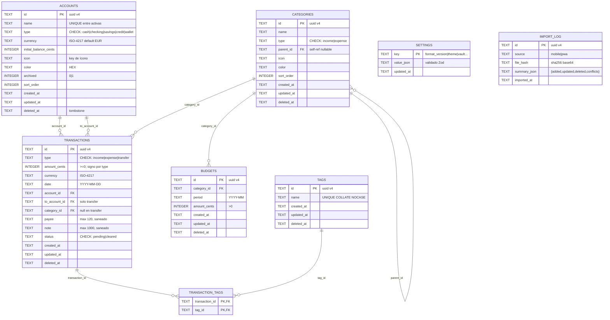

# MODELO_DE_DATOS — Proyecto **Monedero**

> Esquemas de base de datos, diagrama ER (Mermaid) y diccionario de datos.
> DDL **común** a ambas apps (SQLite móvil / sql.js PWA). Versión 1.0 · Aprobado.

---

## 1. Decisiones base

| Regla | Motivo |
|---|---|
| `amount_cents INTEGER` | Precisión exacta; **nunca** FLOAT/REAL en dinero |
| `TEXT` UUID v4 como PK | Merge seguro móvil ⇄ PWA sin colisiones de autoincrement |
| `deleted_at TEXT NULL` (borrado lógico) | Tombstones: el export debe propagar borrados |
| Fechas: `date` (YYYY-MM-DD) + `created_at`/`updated_at` (ISO-8601 UTC) | Dominio vs. auditoría/merge LWW |
| `PRAGMA foreign_keys = ON` + CHECKs | 2ª frontera de validación (después de Zod) |
| Cifrado a nivel de fichero (no por tabla) | SQLCipher (móvil) / blob AES-256-GCM (PWA); la clave jamás toca tablas |
| Migraciones numeradas + `PRAGMA user_version` | Idempotentes, ordenadas, forward-only |

---

## 2. Diagrama Entidad-Relación (Mermaid)



---

## 3. DDL de referencia (`001_init.sql`)

```sql
PRAGMA foreign_keys = ON;

CREATE TABLE accounts (
  id                   TEXT PRIMARY KEY,
  name                 TEXT NOT NULL,
  type                 TEXT NOT NULL CHECK (type IN ('cash','checking','savings','credit','wallet')),
  currency             TEXT NOT NULL DEFAULT 'EUR' CHECK (length(currency) = 3),
  initial_balance_cents INTEGER NOT NULL DEFAULT 0,
  icon                 TEXT NOT NULL DEFAULT 'wallet',
  color                TEXT NOT NULL DEFAULT '#2F7D5B',
  archived             INTEGER NOT NULL DEFAULT 0 CHECK (archived IN (0,1)),
  sort_order           INTEGER NOT NULL DEFAULT 0,
  created_at           TEXT NOT NULL,
  updated_at           TEXT NOT NULL,
  deleted_at           TEXT
);
CREATE UNIQUE INDEX ux_accounts_name_active
  ON accounts(name) WHERE deleted_at IS NULL AND archived = 0;

CREATE TABLE categories (
  id          TEXT PRIMARY KEY,
  name        TEXT NOT NULL,
  type        TEXT NOT NULL CHECK (type IN ('income','expense')),
  parent_id   TEXT REFERENCES categories(id),
  icon        TEXT NOT NULL DEFAULT 'tag',
  color       TEXT NOT NULL DEFAULT '#3D5A80',
  sort_order  INTEGER NOT NULL DEFAULT 0,
  created_at  TEXT NOT NULL,
  updated_at  TEXT NOT NULL,
  deleted_at  TEXT
);

CREATE TABLE transactions (
  id              TEXT PRIMARY KEY,
  type            TEXT NOT NULL CHECK (type IN ('income','expense','transfer')),
  amount_cents    INTEGER NOT NULL CHECK (amount_cents >= 0),
  currency        TEXT NOT NULL DEFAULT 'EUR' CHECK (length(currency) = 3),
  date            TEXT NOT NULL CHECK (date GLOB '[0-9][0-9][0-9][0-9]-[0-9][0-9]-[0-9][0-9]'),
  account_id      TEXT NOT NULL REFERENCES accounts(id),
  to_account_id   TEXT REFERENCES accounts(id),
  category_id     TEXT REFERENCES categories(id),
  payee           TEXT CHECK (length(payee) <= 120),
  note            TEXT CHECK (length(note) <= 1000),
  status          TEXT NOT NULL DEFAULT 'cleared' CHECK (status IN ('pending','cleared')),
  created_at      TEXT NOT NULL,
  updated_at      TEXT NOT NULL,
  deleted_at      TEXT,
  CHECK ((type = 'transfer') = (to_account_id IS NOT NULL)),
  CHECK (type <> 'transfer' OR category_id IS NULL),
  CHECK (account_id <> COALESCE(to_account_id, account_id))
);

CREATE TABLE tags (
  id         TEXT PRIMARY KEY,
  name       TEXT NOT NULL COLLATE NOCASE,
  created_at TEXT NOT NULL,
  updated_at TEXT NOT NULL,
  deleted_at TEXT
);
CREATE UNIQUE INDEX ux_tags_name ON tags(name) WHERE deleted_at IS NULL;

CREATE TABLE transaction_tags (
  transaction_id TEXT NOT NULL REFERENCES transactions(id) ON DELETE CASCADE,
  tag_id         TEXT NOT NULL REFERENCES tags(id) ON DELETE CASCADE,
  PRIMARY KEY (transaction_id, tag_id)
);

CREATE TABLE budgets (
  id            TEXT PRIMARY KEY,
  category_id   TEXT NOT NULL REFERENCES categories(id),
  period        TEXT NOT NULL CHECK (period GLOB '[0-9][0-9][0-9][0-9]-[0-9][0-9]'),
  amount_cents  INTEGER NOT NULL CHECK (amount_cents > 0),
  created_at    TEXT NOT NULL,
  updated_at    TEXT NOT NULL,
  deleted_at    TEXT,
  UNIQUE (category_id, period)
);

CREATE TABLE settings (
  key        TEXT PRIMARY KEY,
  value_json TEXT NOT NULL,
  updated_at TEXT NOT NULL
);

CREATE TABLE import_log (
  id          TEXT PRIMARY KEY,
  source      TEXT NOT NULL CHECK (source IN ('mobile','pwa')),
  file_hash   TEXT NOT NULL,
  summary_json TEXT NOT NULL,
  imported_at TEXT NOT NULL
);

-- Índices de acceso caliente (ver sección 4)
CREATE INDEX idx_tx_date     ON transactions(date DESC) WHERE deleted_at IS NULL;
CREATE INDEX idx_tx_account  ON transactions(account_id, date DESC);
CREATE INDEX idx_tx_category ON transactions(category_id, date DESC);
CREATE INDEX idx_tx_updated  ON transactions(updated_at);
CREATE INDEX idx_tx_payee    ON transactions(payee);
CREATE INDEX idx_cat_parent  ON categories(parent_id);
CREATE INDEX idx_budget_period ON budgets(period);
CREATE INDEX idx_tt_tag      ON transaction_tags(tag_id);
```

---

## 4. Accesos calientes y cobertura de índices

| Consulta (pantalla) | Índice | Nota |
|---|---|---|
| Lista de movimientos (Home) | `idx_tx_date` | `WHERE deleted_at IS NULL` parcial |
| Detalle por cuenta | `idx_tx_account` | rango por fecha |
| Reportes por categoría | `idx_tx_category` | agregaciones `SUM` |
| **Merge import/export (LWW)** | `idx_tx_updated` | barrido incremental por `updated_at` |
| Presupuestos del mes | `idx_budget_period` + `UNIQUE(category_id,period)` | upsert idempotente |
| Búsqueda de payee | `idx_tx_payee` | LIKE prefix |

---

## 5. Diccionario de datos (campos semánticos)

| Campo | Tipo | Dominio | Regla de negocio |
|---|---|---|---|
| `amount_cents` | INTEGER | ≥ 0 | El signo lo determina `type` (`income` +, `expense` −, transferencia mueve de `account_id` a `to_account_id`) |
| `date` | TEXT | `YYYY-MM-DD` | Día calendario local del usuario (no hora);TZ explícita al exportar |
| `type='transfer'` | — | — | `to_account_id NOT NULL`, `category_id NULL`, no cuenta como ingreso/gasto en reportes (solo cambia composición de patrimonio) |
| `status` | enum | `pending`/`cleared` | `pending` = no confirmado por banco; se muestra con chip *Pendiente* (SSOT) |
| `currency` | ISO-4217 | 3 letras | MVP: sin conversión automática; reportes agregan solo moneda principal |
| `settings['format_version']` | integer | ≥1 | Versión del contrato de esquema; informa a `shared/export-contract` |
| `settings['vault']` | JSON | `{kdf, iterations, verifier}` | PBKDF2 params + verificador HMAC (no la clave) |
| `updated_at` | ISO-8601 UTC | — | Se actualiza en cada mutación → motor LWW |
| `deleted_at` | ISO-8601 UTC \| null | — | Tombstone: filtra vistas (`WHERE deleted_at IS NULL`) pero **se exporta** para propagar borrados |

### Transformaciones de presentación (no persisten)
- `formatMoney(cents, currency)` → `€ 12.480,55` (es-ES, `tabular-nums` — exigencia SSOT).
- Categorías padre/hija: presupuesto se evalúa sobre el **árbol** (padre acumula hijos).

---

## 6. Estrategia de migración

```
migrations/
├── 001_init.sql
├── 002_add_payee_index.sql   (ejemplo futuro)
└── ...
```

1. Al abrir BBDD: leer `PRAGMA user_version` → aplicar scripts `> version` en orden → fijar versión.
2. Cada script es **transaccional** (`BEGIN IMMEDIATE … COMMIT`); fallo → rollback y abort (sin BBDD a medias).
3. **Migraciones de datos de usuario = solo forward.** Los ficheros `.monedero` viejos se actualizan con `migrate(vN→vN+1)` de `shared/export-contract` (nunca se degrada una app por un fichero más nuevo: si `formatVersion` > soportado → `IMPORT_FORMAT_UNSUPPORTED` con mensaje "actualiza la app").

---

## 7. Vistas derivadas (no persisten, calculadas)

| Vista | Cálculo | Uso |
|---|---|---|
| Balance de cuenta | `initial_balance_cents + Σ income − Σ expense` (transferencias alteran cuentas, no ingreso/gasto) | Home / cuentas |
| Gasto mensual | `SUM(amount_cents) WHERE type='expense' AND date en mes` | Dashboard, donut |
| Consumo de presupuesto | `gasto(categoría, mes) / budget.amount_cents` | Progress bar (vira `accent` 80% / `danger` 100% — SSOT) |
| Top categorías | `GROUP BY category_id ORDER BY SUM DESC LIMIT N` | Reportes |

---

## 8. Seguridad de los datos (resumen → `GUIA_DEVOPS_SEGURIDAD.md`)

- **En reposo:** SQLCipher (móvil) / blob AES-256-GCM en IndexedDB (PWA).
- **En memoria:** claves solo con bóveda desbloqueada; `zeroize` al bloquear.
- **Export:** hash SHA-256 canónico en el fichero; variante `.enc` cifrada con passphrase.
- **Sin PII en logs;** `android:allowBackup="false"`.
