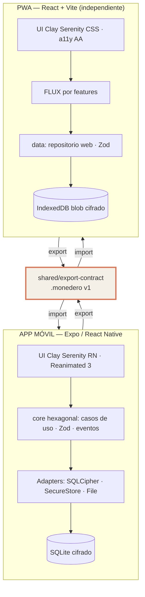

# README_ARQUITECTURA — Proyecto **Monedero** (gestor de gastos local-first)

> **Documento maestro de arquitectura.** Fuente de verdad técnica del proyecto.
> Complementa al SSOT visual: `Artefactos/documentacion/Diseño Visual/manual-identidad-visual.md`.
> Versión: **1.0** · Fecha: 2026-10-11 · Estado: **APROBADO por el usuario**

---

## 1. Resumen ejecutivo

**Monedero** es una aplicación de gestión financiera personal **100% local** (soberanía de datos), compuesta por **dos aplicaciones independientes** con arquitecturas diferenciadas:

| App | Stack | Persistencia | Cifrado |
|---|---|---|---|
| 📱 **Móvil** (iOS + Android) | Expo · React Native · TypeScript · Hexagonal ligera | SQLite (**SQLCipher** AES-256) | Keychain/Keystore (clave maestra) |
| 🌐 **PWA** (escritorio) | React · Vite · TypeScript · FLUX por features | sql.js (WASM) + IndexedDB | **WebCrypto AES-256-GCM** + PBKDF2 120k |

**Único acoplamiento:** el contrato de archivo **`.monedero` v1** (`shared/export-contract`) — exportación/importación bidireccional móvil ⇄ PWA. **Cero servidores, cero API de red, cero telemetría.**

> El producto **es** la ausencia de backend: el copy y el diseño jamás pedirán "subir a la nube" (pilar *Soberanidad* del SSOT visual).

---

## 2. Stack aprobado (Paso 2)

### 2.1 Móvil
| Categoría | Elección | Alternativa descartada |
|---|---|---|
| Framework | **Expo SDK + React Native + TS strict** | Flutter (PWA débil), bare RN (operación), KMP (overkill) |
| Navegación | Expo Router (file-based, tipada) | React Navigation solo |
| Estado UI | **Zustand** | Redux Toolkit (verboso), Jotai (overkill) |
| Datos | Repositorio SQLite reactivo (`subscribe`) | Realm/WatermelonDB |
| Animaciones | **Reanimated 3** (UI thread → springs 60fps) | Animated core (JS thread) |
| Validación | **Zod** + reglas de dominio | Yup |
| BD | `expo-sqlite` / `op-sqlite` + **SQLCipher** | sin cifrar (vetado) |
| Gráficos | `react-native-svg` + charts propios | victory-native (peso) |

### 2.2 PWA
| Categoría | Elección | Alternativa descartada |
|---|---|---|
| Framework | **React 18 + Vite + TS** | Next.js (sin SSR necesario), RN Web (arquitectura compartida → vetada por decisión de independencia) |
| Patrón | **FLUX por features** | MVC genérico |
| PWA/Offline | `vite-plugin-pwa` (Workbox, cache-first shell) | manual SW |
| BD | **sql.js (WASM)** + persistencia IndexedDB (blob cifrado) | IndexedDB crudo (sin SQL para reportes) |
| Cifrado | **WebCrypto AES-256-GCM** + PBKDF2 ≥120.000 | SQLCipher (inexistente en browser) |
| Estado | Zustand por feature | Redux |

### 2.3 Común
- **Monorepo pnpm + Turborepo**: `apps/mobile`, `apps/web`, `shared/export-contract`, `tools/`.
- **Tooling:** ESLint flat + Prettier + `tsc --noEmit`; tests Jest+RNTL (móvil), Vitest (PWA), Maestro (E2E móvil), Playwright + **axe-core** (E2E/a11y PWA).
- **Design system:** implementación doble (tema TS en RN / CSS vars `--cs-*` en web) con **fuente única = SSOT visual** y verificación por `tools/tokens:check`.

---

## 3. Patrones y principios (Paso 3)

1. **Hexagonal ligera (Ports & Adapters) en el móvil** — el dominio financiero no importa React ni SQLite; los hosts implementan puertos (`TransactionRepository`, `KeyVaultPort`, `ExportPort`, `CryptoPort`).
2. **FLUX por features en la PWA** — carpetas autocontenidas (`store + hooks + components + page`).
3. **Dependencias hacia dentro:** `apps → infrastructure → core` (el core jamás importa UI ni RN/web).
4. **Reactividad por suscripción** del repositorio → re-renders selectivos (clave para 60fps con sombras clay).
5. **Estado en 4 niveles:** local (useState) → UI (Zustand) → datos (repositorio = fuente de verdad) → seguro (Keystore/WebCrypto, nunca en JS salvo sesión desbloqueada).
6. **Security by Design** desde el modelado: Zod en toda frontera, enteredes de céntimos, UUIDs, borrado lógico, SQL parametrizado.
7. **Pragmatismo MVP:** sin microservicios, sin sync en vivo, sin colas. Extensible: UUIDs + `formatVersion` preparan un futuro sync sin breaking changes.



---

## 4. ADR — Architecture Decision Records

### ADR-001: Local-first sin backend
- **Contexto:** público privacy-conscious; problema = servicios en la nube que monetizan datos.
- **Decisión:** cero servidores; SQLite cifrado local como única persistencia; distribución por tiendas + hosting estático.
- **Alternativas:** backend REST + sync ( Mint-like), P2P — descartadas por complejidad y por contradecir el pilar de marca.
- **Consecuencias:** ✅ soberanía total, 100% offline, coste operativo ~0. ❌ sin multi-device sync en vivo (mitigado: export/import `.monedero`), backups responsabilidad del usuario (UI debe educar).

### ADR-002: Dos apps independientes con único acoplamiento por archivo
- **Contexto:** PWA debía funcionar de manera independiente con arquitectura diferenciada (decisión explícita del usuario).
- **Decisión:** codebases separadas; comparten **solo** `shared/export-contract` (esquema Zod + migraciones + hash del fichero `.monedero`).
- **Alternativas:** monorepo con RN Web compartido (descartada por el usuario); duplicar el contrato en ambas apps (descartada: riesgo de drift).
- **Consecuencias:** ✅ independencia total, despliegues separados, fallo aislado. ❌ UI Clay implementada 2 veces (mitigado: SSOT + `tokens:check`), cambios de formato requieren tocar 1 lado de código pero 2 apps.

### ADR-003: SQLite cifrado (SQLCipher en móvil, WebCrypto en PWA)
- **Contexto:** datos financieros sensibles en disco del dispositivo.
- **Decisión:** SQLCipher (AES-256 a nivel de fichero) en móvil; blob AES-256-GCM antes de IndexedDB en PWA. Clave maestra en SecureEnclave/Keystore (móvil) o CryptoKey no extraíble en memoria (PWA).
- **Alternativas:** Realm (licencia/feature creep), sqlcipher-js en web (inexistente), DB sin cifrar (vetado).
- **Consecuencias:** ✅ at-rest encryption real en ambas plataformas. ❌ PWA depende de contexto seguro (HTTPS) y de que el usuario no pierda la passphrase (no hay recuperación → UI debe advertirlo).

### ADR-004: Moneda en enteros (céntimos) + UUID v4 PK + borrado lógico
- **Contexto:** finanzas con precisión exacta; merge bidireccional móvil⇄PWA.
- **Decisión:** `amount_cents INTEGER`; PKs UUID v4 TEXT; `deleted_at` (tombstones).
- **Alternativas:** REAL (errores de redondeo), autoincrement (colisiones en merge), hard delete (imposible propagar borrados).
- **Consecuencias:** ✅ integridad exacta, merges seguros, export completo. ❌ migraciones manuales de datos legacy si aparecieran (no aplica: greenfield).

### ADR-005: Hexagonal (móvil) vs FLUX por features (PWA)
- **Contexto:** el móvil beneficia de puertos por sus 3 límites (RN, seguridad nativa, ficheros); la web beneficia de features autocontenidas.
- **Decisión:** patrón distinto por plataforma, **mismo dominio conceptual**.
- **Consecuencias:** ✅ cada app usa el patrón natural de su ecosistema. ❌ dos formas de organizar → onboarding documentado en `ESTRUCTURA_DIRECTORIOS.md`.

### ADR-006: Merge LWW (Last-Write-Wins) por `updatedAt`
- **Contexto:** import/export bidireccional sin servidor de coordinación.
- **Decisión:** gana el `updatedAt` más reciente por UUID; `ImportSummary` reporta conflictos; modo `replace` destructivo con confirmación + backup previo.
- **Alternativas:** merge por campos (complejidad sin beneficio MVP), CRDT (overkill).
- **Consecuencias:** ✅ determinista y simple. ❌ edits casi simultáneos en ambos extremos pueden perder el más viejo (aceptable: escenario raro de uso personal).

### ADR-007: React + Vite (no Next.js) para la PWA
- **Contexto:** SPA 100% offline, sin SSR ni SEO.
- **Decisión:** Vite + `vite-plugin-pwa`.
- **Consecuencias:** ✅ build mínimo, SW simple, deploy estático. ❌ sin SSR (irrelevante para app autenticada localmente).

### ADR-008: Motor de sesión móvil = expo-sqlite nativo, BD en memoria + snapshot cifrado (interino hasta SQLCipher)
- **Contexto:** el motor interim sql.js (build asm.js, Emscripten) alcanza 294 niveles de anidamiento que el compilador de Hermes (`hermesc`) rechaza en builds release (límite duro ~1000, facebook/hermes#628) → imposible generar APK/AAB con Hermes. Además el asm.js es JS interpretado (rendimiento inferior al SQLite nativo ya aprobado en ADR-003/§2.1).
- **Decisión:** la sesión corre sobre **expo-sqlite (SQLite nativo, Expo Go compatible)** con la BD **en memoria** (`deserializeDatabaseAsync` desde el snapshot / `:memory:` fresca). `serializeAsync()` (sqlite3_serialize) es el espejo exacto del antiguo `db.export()` de sql.js. El **snapshot AES-256-GCM con clave de bóveda** (ADR-003) sigue siendo la ÚNICA persistencia en disco: cero plaintext en reposo, semántica idéntica a la anterior. El motor queda tras el puerto `DevEngine` (runtime: expo-sqlite; jest: sql.js equivalente).
- **Alternativas:** JSC en release (divergencia de motor dev/prod), sql.js wasm embebido en base64 (+1 MB, sigue sin cifrar el fichero), SQLCipher directo (exige dev-build propio, no corre en Expo Go).
- **Consecuencias:** ✅ builds release con Hermes, SQLite nativo, ADR-003 íntegro, alineación con §2.1. ❌ el fichero de la BD aún no es SQLCipher a nivel de fichero (pendiente el dev-build de la deuda D1); sql.js permanece SOLO en jest (fuente de verdad de la suite).

---

## 5. Directrices de código

| Regla | Detalle |
|---|---|
| TypeScript | `strict: true`, sin `any` (excepción justificada con `// eslint-disable` + comentario) |
| inmutabilidad | datos de dominio `readonly`/`as const`; updates por spread |
| errores | doming tipados (`{code: DomainErrorCode, field?}`) — ver `CONTRATOS_API.md`; nunca `throw` de strings |
| dinero | **solo** `MoneyCents` (branded type `number & {__money:true}`), helpers `formatMoney()` |
| fechas | ISO-8601 UTC; presentación local vía formatter |
| logs | sin importes/payees/notas (A09) |
| componentes UI | consumir **solo** tokens `--cs-*`/`csColors`; prohibido HEX literal fuera del design-system |
| tests | `core`/`data` con cobertura ≥70% · regresión visual a11y con axe |

## 6. Decisiones explícitamente NO tomadas (MVP)

- ❌ Sync en vivo / WebSockets / backend de cualquier tipo.
- ❌ Cuentas de usuario, OAuth, recuperación de contraseña remota.
- ❌ Multi-moneda conversión en vivo (se almacena moneda ISO-4217; cambio manual).
- ❌ Recurrentes automáticos (modelo preparado vía tablas, lógica en fase 2).
- ❌ Colaboración familiar multiusuario (futuro: mismo archivo como canal).

## 7. Rutas de la documentación

```
Artefactos/documentacion/
├── Diseño Visual/manual-identidad-visual.md        # SSOT visual
├── Prototipos/prototipo-b-clay-serenity.html       # diseño aprobado
└── Arquitectura/
    ├── README_ARQUITECTURA.md                      # ← este documento
    ├── ESTRUCTURA_DIRECTORIOS.md
    ├── MODELO_DE_DATOS.md
    ├── CONTRATOS_API.md
    └── GUIA_DEVOPS_SEGURIDAD.md
```
