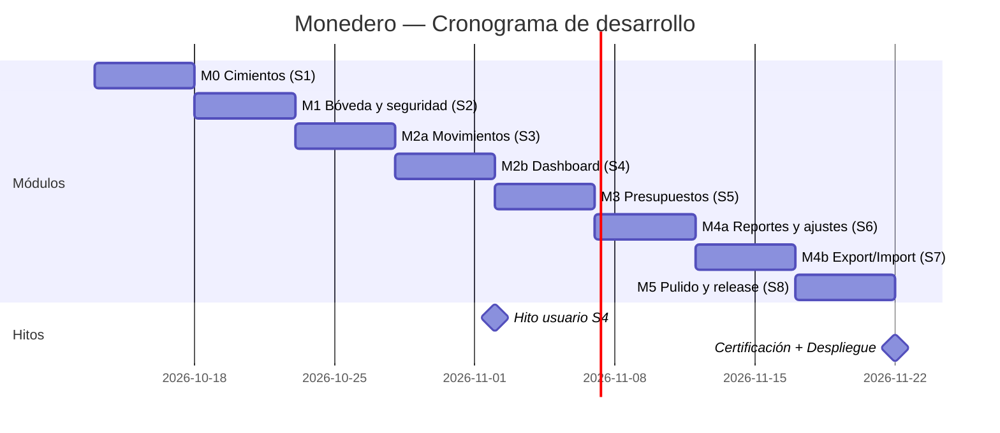

# Plan de Sprints — Monedero

> **Fase Orquestadora · Paso 1** · Cronograma de ejecución del desarrollo completo.
> Fuentes vinculantes: `ESTRUCTURA_DIRECTORIOS.md` + `README_ARQUITECTURA.md` (Skill 2) ·
> `BLUEPRINTS_DE_PANTALLAS.md` + `FLUJOS_DE_USUARIO.md` (Skill 3) · estándares de `Calidad y Gobernanza` (Skill 4).
> **Paso 6/7 (backend/integración) N/A** — sin backend por ADR-001; sustituidos por pruebas de puertos y repositorios locales.

---

## 1. Metodología

- **Monorepo pnpm + Turborepo**: `apps/mobile` (Expo+RN), `apps/pwa` (React+Vite), `packages/*` compartidos.
- **Sprints de 1 semana** con gate de calidad al cierre (checks CI verdes + auditoría In-Flight).
- **DoD obligatorio** (Skill 4 A.1): código + tests TDD (dominio) + i18n + a11y + 4 estados + flag si aplica + 1 aprobación.
- **Hito de aprobación del usuario** tras M2 (primer valor completo) y al cierre (Paso 10).

## 2. Módulos y priorización

| Módulo | Sprint | HU | Criticidad | Dependencias |
|--------|--------|----|------------|--------------|
| **M0 · Cimientos** | S1 | — | Bloqueante | Ninguna |
| **M1 · Bóveda y seguridad** | S2 | HU-01·02·03·04 | Bloqueante | M0 |
| **M2 · Movimientos y dashboard** | S3–S4 | HU-05·06·07·08·09 | Máxima (valor core) | M1 |
| **M3 · Organización y presupuestos** | S5 | HU-10·11·12 | Alta | M2 |
| **M4 · Reportes, ajustes y soberanía** | S6–S7 | HU-13·17·18·19 + HU-14·15·16 | Alta | M2 (export: M1 vault) |
| **M5 · Pulido, i18n, a11y y release** | S8 | HU-20 | Alta | Todos |

---

## 3. Desglose detallado por sprint

### S1 — M0 · Cimientos del monorepo  *(complejidad global: Media)*

| # | Tarea | Paquete | Comp. | Trazabilidad |
|---|-------|---------|-------|--------------|
| 1.1 | Init pnpm + Turborepo + TS strict + ESLint/Prettier + husky/commitlint/lint-staged | raíz | Media | `GOBERNANZA_GIT.md` |
| 1.2 | Estructura de carpetas completa (apps + packages) | raíz | Baja | `ESTRUCTURA_DIRECTORIOS.md` |
| 1.3 | `packages/tokens`: tokens `--cs-*` (JSON → CSS vars, constants RN, tailwind preset) + gate `tokens:check` | tokens | Media | `manual-identidad-visual.md` |
| 1.4 | `packages/i18n`: i18next + es-CO/en-US + `formatMoney` (shared/money) + test expansión +30% | i18n | Media | `ESTANDAR_INTERNACIONALIZACION.md`, HU-18 |
| 1.5 | `packages/flags`: `isFlagEnabled` + `flags:lint` (90 días, naming) | flags | Baja | `ESTRATEGIA_FEATURE_FLAGS.md` |
| 1.6 | `packages/telemetry-local`: logger JSON ring-buffer PII-free + traceId | telemetry | Media | `ESTRATEGIA_OBSERVABILIDAD.md` |
| 1.7 | Pipelines CI GitHub Actions: typecheck, lint, test, coverage:gate, a11y, tokens:check, contract:check, no-network | ci | Alta | `MANIFIESTO_CALIDAD.html` gates |
| 1.8 | Scaffold Expo (apps/mobile) + Vite (apps/pwa) compilando «hola mundo» con tokens | apps | Media | Paso 2 Orquestador |

**Gate S1:** ambos apps compilan · CI verde · tokens consumibles en las dos plataformas.

### S2 — M1 · Bóveda y seguridad (E1/E2)  *(Alta)*

| # | Tarea | Fuente | Comp. |
|---|-------|--------|-------|
| 2.1 | `packages/db`: esquema `001_init.sql` (8 tablas) + migraciones numeradas + sql.js en memoria para tests | `MODELO_DE_DATOS.md` | Alta |
| 2.2 | `packages/contract`: esquema Zod `MonederoFileSchema` v1 + fixtures matrix (v1/corrupto/futuro/hash alterado) | `CONTRATOS_API.md` | Alta |
| 2.3 | `KeyVaultPort` + impl. mobile (expo-secure-store, PBKDF2 120k) y web (WebCrypto AES-256-GCM) — **TDD** | `CONTRATOS_API.md` | Alta |
| 2.4 | Onboarding BP-01 (4 pasos): crear bóveda, custodia, biometría, moneda — 4 estados | `BLUEPRINTS` BP-01, F1 | Alta |
| 2.5 | VaultGate BP-02: guard global, zeroize, backoff 5 fallos, restauración de ruta | `BLUEPRINTS` BP-02, F2 | Alta |
| 2.6 | E2E Maestro/Playwright: F1 feliz + mismatch · F2 feliz + backoff | `FLUJOS` F1/F2 | Media |

**Gate S2:** HU-01…04 con DoD completo · E2E verdes · axe-core limpio en onboarding/vault.

### S3 — M2a · Movimientos: dominio y alta (E3)  *(Máxima)*

| # | Tarea | Fuente | Comp. |
|---|-------|--------|-------|
| 3.1 | Dominio `Transaction` (centavos enteros, transferencias CHECK, tombstones) + repositorio SQL — **TDD estricto** | `MODELO_DE_DATOS`, HU-05·06·07 | Alta |
| 3.2 | Casos de uso: `addTransaction`, `update`, `softDelete/restore` + eventos `tx:created` | `CONTRATOS_API.md` | Alta |
| 3.3 | Componentes DS móvil: `.money-input`, `.segmented`, `.chip`, sheet detalle | manual SSOT | Media |
| 3.4 | Componentes DS PWA idénticos (tokens compartidos) | manual SSOT | Media |
| 3.5 | BP-05 alta de movimiento (4 estados, validación Zod inline) | `BLUEPRINTS` BP-05 | Alta |
| 3.6 | BP-04 lista + filtros + búsqueda + swipe deshacer 4 s | `BLUEPRINTS` BP-04, F3 | Alta |

**Gate S3:** alta/borrado funcionando con dinero correcto (centavos) en ambas apps.

### S4 — M2b · Dashboard y consulta (E4)  *(Alta)*

| # | Tarea | Fuente | Comp. |
|---|-------|--------|-------|
| 4.1 | `computeBalance` + `getByMonth` (repositorio, índices) — **TDD** | HU-08·09 | Media |
| 4.2 | BP-03 Inicio: BalanceCard contador animado (Reanimated/SVG), segmented periodo, 4 estados | `BLUEPRINTS` BP-03 | Alta |
| 4.3 | Sincronía store (Zustand mobile / FLUX PWA): `tx:created` actualiza balance | ADR | Media |
| 4.4 | E2E F3 completo (alta → balance → deshacer) | `FLUJOS` F3 | Media |

**Gate S4 (🎯 Hito usuario):** recorrido completo de un día real: abrir → desbloquear → registrar gasto/ingreso → ver balance. **Aprobación del usuario.**

### S5 — M3 · Organización y presupuestos (E5/E6)  *(Alta)*

| # | Tarea | Fuente | Comp. |
|---|-------|--------|-------|
| 5.1 | Categorías jerárquicas + tags (NOCASE, archivado) — repositorio + casos | HU-10 | Media |
| 5.2 | Ajustes → Categorías (gestión) | BP-08 sub | Media |
| 5.3 | `budgets.upsert` idempotente + `evaluateBudgets` umbrales 80/100 — **TDD** | HU-11·12 | Alta |
| 5.4 | BP-06 presupuestos: barras semánticas, toast `budget:exceeded` | `BLUEPRINTS` BP-06, F4 | Alta |
| 5.5 | E2E F4 (feliz + duplicado) | `FLUJOS` F4 | Baja |

**Gate S5:** presupuestos con alertas serenas; unicidad garantizada.

### S6 — M4a · Reportes, apariencia y moneda  *(Media-Alta)*

| # | Tarea | Fuente | Comp. |
|---|-------|--------|-------|
| 6.1 | `computeMonthReport` (byCategory) — **TDD** | HU-13 | Media |
| 6.2 | BP-07 donut accesible (`aria-label` + tabla alternativa) | `BLUEPRINTS` BP-07 | Alta |
| 6.3 | BP-08 Ajustes raíz + tema claro/oscuro (variantes SSOT) | HU-17 | Media |
| 6.4 | Moneda/formato global COP-USD-EUR (selector + `formatMoney` en todas las vistas) | HU-18 | Media |
| 6.5 | Zona de peligro F6 (borrar total, doble confirmación, snapshot) | HU-19, F6 | Media |

**Gate S6:** reportes usables por Elena; tema y moneda consistentes.

### S7 — M4b · Soberanía: Export ⇄ Import (E8)  *(Alta)*

| # | Tarea | Fuente | Comp. |
|---|-------|--------|-------|
| 7.1 | `ExportPort`: serializar → AES-256-GCM → SHA-256 (móvil y web) — **TDD + fixtures matrix** | `CONTRATOS_API`, HU-14 | Alta |
| 7.2 | Import: Zod → hash → decrypt → **merge LWW** + `ImportSummary` — **TDD estricto** | HU-15 | Alta |
| 7.3 | BP-09 export (4 estados, Share nativo / descarga web) | `BLUEPRINTS` BP-09 | Media |
| 7.4 | BP-10 import: merge/replace con snapshot + 3 errores `IMPORT_*` | `BLUEPRINTS` BP-10, F5 | Alta |
| 7.5 | E2E F5 móvil→PWA y PWA→móvil (archivo real) | `FLUJOS` F5 | Alta |

**Gate S7:** intercambio real entre plataformas verificado E2E — único acoplamiento (ADR-002) certificado.

### S8 — M5 · Pulido, i18n, a11y y release (E10)  *(Alta)*

| # | Tarea | Fuente | Comp. |
|---|-------|--------|-------|
| 8.1 | Barrido i18n: cero hardcode, claves completas, revisión en-US | A.2 | Media |
| 8.2 | Auditoría a11y completa: axe-core todas las rutas, teclado/lector, VoiceOver/TalkBack manual | A.3 | Alta |
| 8.3 | Performance: listas 1.000 filas, arranque <1,5 s, skeletons, reduced-motion | A.4 | Media |
| 8.4 | CI/CD finales: EAS Build/Submit config + Cloudflare Pages + GitHub Actions release | `GUIA_DEVOPS` | Alta |
| 8.5 | Docs de desarrollo: README, CONTRIBUTING, guía de arquitectura para devs | Paso 9 | Baja |
| 8.6 | **Fase C Calidad**: suite completa, certificación, deuda técnica, checklist desplegable | Skill 4 Fase C | Alta |

**Gate S8 (🎯 Hito final):** certificación de calidad + despliegue. **Aprobación final del usuario (Paso 10).**

---

## 4. Cronograma visual

## 5. Registro de riesgos

| Riesgo | Impacto | Mitigación |
|--------|---------|------------|
| WebCrypto/PBKDF2 120k lento en PWA vieja | Alto | Medir en S2; fallback progresivo con WebWorker |
| Merge LWW con tombstones complejo | Alto | TDD estricto + fixtures deterministas (semilla) |
| Reanimated 3 en Expo SDK | Medio | Fijar versiones en S1; `prefers-reduced-motion` desde S3 |
| Diferencias RN vs web en DS | Medio | Un solo paquete `packages/tokens` + golden tests visuales |
| Alcance de moneda sin conversión | Bajo | Confirmado MVP: solo formato (HU-18) |

## 6. Seguimiento de progreso

| Sprint | Módulo | Estado | % acumulado |
|--------|--------|--------|-------------|
| S1 | M0 Cimientos | ⏳ Pendiente | 0% |
| S2 | M1 Bóveda | ⏳ | 12% |
| S3 | M2a Movimientos | ⏳ | 37% |
| S4 | M2b Dashboard | ⏳ | 50% (🎯 hito) |
| S5 | M3 Presupuestos | ⏳ | 62% |
| S6 | M4a Reportes/ajustes | ⏳ | 75% |
| S7 | M4b Export/Import | ⏳ | 87% |
| S8 | M5 Release | ⏳ | 100% (🎯 certificación) |

> El % refleja valor entregado por módulo (peso acorde a HU y criticidad). El Orquestador actualizará esta tabla tras cada sprint y mantendrá `memoriaOrquestador.estadoProyecto` sincronizada.
