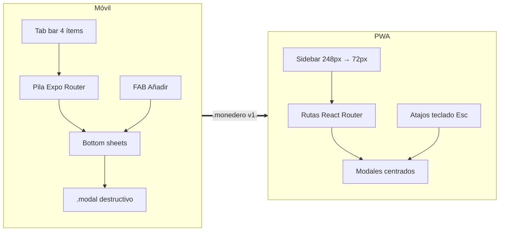

# Arquitectura de la Información — Monedero

> **Fase 3 · Paso 3** · Fuente de verdad del sitemap y las reglas de navegación.
> **Showcase interactivo:** `Artefactos/documentacion/ArquitecturaInformacion/ARQUITECTURA_INFORMACION_VISUAL.html`

---

## 1. Sitemap (árbol de pantallas)

```mermaid
graph TD
  ROOT[App Monedero] --> OB[Onboarding · 1ª vez]
  ROOT --> VG((VaultGate · guard global))
  ROOT --> TABS[Tabs raíz / Sidebar PWA]

  OB --> OB1[01 Bienvenida]
  OB --> OB2[02 Crear bóveda · HU-01]
  OB --> OB3[03 Biometría · HU-02]
  OB --> OB4[04 Moneda COP/USD/EUR · HU-18]

  TABS --> H[1 · Inicio · HU-08·09]
  TABS --> M[2 · Movimientos · HU-05·06·07]
  TABS --> P[3 · Presupuestos · HU-11·12]
  TABS --> A[4 · Ajustes]

  H --> BC[BalanceCard + .segmented]
  H --> ALERT[Alertas presupuesto · HU-12]
  H --> R[Reportes · HU-13]

  M --> ML[Lista + filtros + búsqueda]
  M --> MF[Alta movimiento · sheet · HU-05·06]
  M --> MD[Detalle/Editar/Eliminar · sheet · HU-07]

  P --> PL[Lista con .progress]
  P --> PA[Alta/edición meta]

  A --> AS[Seguridad · HU-02·03]
  A --> AC[Cuentas]
  A --> AK[Categorías y etiquetas · HU-10]
  A --> AM[Moneda y formato · HU-18]
  A --> AT[Apariencia · HU-17]
  A --> AD[Datos: Export/Import · HU-14·15·16]
  A --> AZ[Zona de peligro · HU-19]
  A --> AI[Acerca de]

  VG -.redirige a.-> VGK[Pantalla de bloqueo · HU-03·04]

  style VG fill:rgba(61,90,128,.15)
  style ROOT fill:rgba(47,125,91,.18)
```

**Conteo:** 18 nodos/pantallas · 4 tabs raíz · 2 shells (móvil/PWA) · 4 estados por pantalla.

---

## 2. Navegación por plataforma



| Regla | Móvil | PWA |
|-------|-------|-----|
| Navegación primaria | `.tabbar` inferior (64px + safe-area), activo `primary-soft` | Sidebar persistente, colapsable |
| Detalle/edición | Bottom sheet (swype-to-dismiss) | Modal centrado + `Esc` |
| FAB «Añadir» | Inicio y Movimientos | Botón primario en cabecera |
| Back | Cerrar sheet → pila → salir | Historial del navegador |
| Deep links | `monedero://movimientos/:id` | `/movimientos/:id` |
| Único acoplamiento | `shared/export-contract` (`.monedero` v1, merge LWW) — ADR-002 | idem |

---

## 3. Guardarraíles de navegación

| # | Regla | Detalle |
|---|-------|---------|
| 1 | **VaultGate global** | Si `vault:locked` dispara, cualquier ruta redirige a bloqueo **conservando ruta y scroll** para restaurar tras desbloquear. |
| 2 | **Profundidad ≤ 3** | Tab → pantalla → sheet. Acciones destructivas con `.modal` (nunca nueva ruta). |
| 3 | **Sin hover en móvil** | Hover solo en PWA; en móvil `:active` (squish clay) + háptico. |
| 4 | **Targets y focus** | Zonas navegables ≥44×44px; `focus-visible` 3px; el tab activo comunica con color **y** fondo. |
| 5 | **Back predecible** | Cerrar > volver > salir. Filtros y periodo sobreviven al back (estado en store UI). |
| 6 | **Estados completos** | Toda pantalla declara loading / empty / success / error con componentes de feedback SSOT. |

---

## 4. Correspondencia tabs ↔ secciones

| Tab | Ícono | Sección | Pantallas hijas |
|-----|-------|---------|-----------------|
| 1 | ◧ | Inicio | BalanceCard, alertas, acceso a Reportes |
| 2 | ⇄ | Movimientos | Lista, alta sheet, detalle sheet |
| 3 | ◔ | Presupuestos | Lista, alta/edición meta |
| 4 | ☰ | Ajustes | Seguridad, cuentas, categorías, moneda, apariencia, datos, peligro, acerca de |
