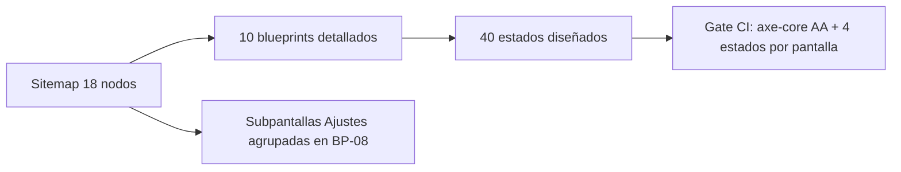

# Blueprints de Pantallas — Monedero

> **Fase 3 · Paso 4** · Fuente de verdad de la composición de cada pantalla.
> **Showcase interactivo:** `Artefactos/documentacion/Blueprints/BLUEPRINTS_VISUAL.html` (storybook con conmutador de 4 estados).
> **Regla de Oro:** cada componente citado existe en el SSOT *Clay Serenity* (Skill 1); cada entidad/contrato en `MODELO_DE_DATOS.md` / `CONTRATOS_API.md` (Skill 2).

---

## Leyenda de estados (obligatorios los 4)

| Estado | Componente SSOT | Regla |
|--------|-----------------|-------|
| Loading | `.spinner` · skeleton shimmer | >200ms ⇒ skeleton; nunca pantalla en blanco |
| Empty | `.empty` | Ilustración clay + copy sereno + **un** CTA primario |
| Success | `.toast` (borde 4px) · contadores animados | Feedback inmediato y sereno |
| Error | `.fhint error` · `.toast err` | Código de dominio localizado + reintento; nunca culpar al usuario |

---

## BP-01 · Onboarding — Crear bóveda

- **Ruta:** `/onboarding/crear` · **HU:** 01 · **Actor:** A1/A2/A3
- **Propósito:** configurar la passphrase que cifrará la bóveda local y educar sobre custodia antes del primer dato.
- **Composición (Skill 1):** `.input` (passphrase ×2) · `.btn primary` · `.progress` · `.fhint error` · `.modal` (aviso custodia)
- **Datos (Skill 2):** `settings['vault']` · PBKDF2 ≥120k · `KeyVaultPort` · `VALIDATION_FAILED`

| Estado | Comportamiento |
|--------|----------------|
| Loading | `.progress` de derivación + CTA deshabilitado |
| Empty | Formulario pristine; CTA deshabilitado hasta válido; CTA secundario «Importar» |
| Success | `.input` focus + modal de custodia obligatorio (checkbox «Entiendo») |
| Error | Confirmación distinta → `VALIDATION_FAILED` field:confirm, `.fhint error` |

## BP-02 · Bloqueo (VaultGate)

- **Ruta:** guard global · **HU:** 03·04 · **Actor:** A4 (Bóveda)
- **Propósito:** cubrir toda la app ante inactividad (2 min) o segundo plano; restaurar ruta y scroll tras desbloquear.
- **Composición:** `.btn primary` · `.input` · `.spinner` · `.fhint error` · biometría nativa
- **Datos:** `vault:locked` · `KeyVaultPort.unlock()` · `VAULT_LOCKED` · zeroize

| Estado | Comportamiento |
|--------|----------------|
| Loading | `.spinner` mientras valida el SO |
| Empty (locked) | Copy sereno + botones biometría y passphrase |
| Success | `vault:unlocked` → ruta previa con filtros y scroll |
| Error | 5 fallos → backoff 30 s (`:disabled` + temporizador); datos intactos |

## BP-03 · Inicio (Dashboard)

- **Ruta:** `/home` · **HU:** 08·09·12 · **Actor:** A2
- **Propósito:** responder «¿cuánto queda?» en <3 s: balance, delta, alertas y últimos movimientos.
- **Composición:** `.card balance` · `.segmented` · `.tx` · `.progress` · `.toast warn` · `.spinner` · `.empty`
- **Datos:** `accounts` · `transactions` · `budgets` · `computeMonthReport()`

| Estado | Comportamiento |
|--------|----------------|
| Loading | Skeletons shimmer (sin flash de vacío) |
| Empty | Balance $ 0 + `.empty` con CTA «Añadir primer movimiento» |
| Success | Contador animado (`COP $ 12.480.550`), alerta 85% accent, filas `.tx` |
| Error | `STORAGE_UNAVAILABLE` → reintento + alternativa importar backup |

## BP-04 · Movimientos (lista)

- **Ruta:** `/movimientos` · **HU:** 07·09 · **Actor:** A1
- **Propósito:** listado con filtros/búsqueda; acceso al sheet de detalle con editar/eliminar.
- **Composición:** `.tx` · `.segmented` · `.chip` · `.toast "Deshacer"` · `.modal`
- **Datos:** `TransactionRepository.list()` · `transactions` (tombstones) · `categories` · `tags`

| Estado | Comportamiento |
|--------|----------------|
| Loading | Skeleton de filas |
| Empty | `.empty` contextual (sin datos vs. filtro sin resultados) |
| Success | Chips de filtro activos, montos con signo + color, paginación incremental |
| Error | `.toast err` con `INTEGRITY_VIOLATION`; conserva último estado válido |

## BP-05 · Alta de movimiento

- **Ruta:** `/movimientos/nuevo` (sheet) · **HU:** 05·06
- **Propósito:** alta rápida validada en tiempo real (importe, tipo, concepto, categoría, cuenta).
- **Composición:** `.money-input` · `.segmented` · `.input` · `.chip` · `.btn primary` · `.fhint error`
- **Datos:** `addTransaction()` · `TxInputSchema` · evento `tx:created`

| Estado | Comportamiento |
|--------|----------------|
| Loading | Botón spinner + campos bloqueados (sin pérdida de datos) |
| Empty | Defaults: tipo Gasto, cuenta Efectivo; CTA deshabilitado |
| Success | `tx:created` → `.toast ✓` + fila nueva con spring |
| Error | Importe 0 → `VALIDATION_FAILED` field:amount; transf. sin destino → `INTEGRITY_VIOLATION` |

## BP-06 · Presupuestos

- **Ruta:** `/presupuestos` · **HU:** 11·12 · **Actor:** A2
- **Propósito:** metas por categoría/periodo con barra semántica y alertas `budget:exceeded`.
- **Composición:** `.progress` · `.chip` · `.money-input` · `.btn primary` · `.toast warn` · `.empty`
- **Datos:** `budgets` (UNIQUE category+period) · `evaluateBudgets()` · `categories`

| Estado | Comportamiento |
|--------|----------------|
| Loading | Skeleton de barras |
| Empty | `.empty` «Define un tope por categoría» + CTA único |
| Success | Verde normal · accent 85% · danger 100% (nunca rojo de castigo) |
| Error | `VALIDATION_FAILED` (importe ≤0) · `INTEGRITY_VIOLATION` (duplicado) → editar existente |

## BP-07 · Reportes

- **Ruta:** `/reportes/:month` · **HU:** 13 · **Actor:** A1
- **Propósito:** análisis mensual exportable para la asesoría.
- **Composición:** `.segmented` mes · `.tx` (tabla) · `.chip` · `.empty` · `.btn secondary` · `.spinner`
- **Datos:** `computeMonthReport()` · `byCategory[]` · react-native-svg / SVG web

| Estado | Comportamiento |
|--------|----------------|
| Loading | `.spinner` + skeletons mientras agrega SUM |
| Empty | Mes sin gastos → `.empty` con CTA |
| Success | Donut paleta semántica con `role="img"` + `aria-label` + tabla alternativa |
| Error | `EXPORT_FAILED` localizado + reintento |

## BP-08 · Ajustes (raíz)

- **Ruta:** `/ajustes` · **HU:** 17·18
- **Propósito:** hub de seguridad, personalización (tema, moneda) y soberanía (export/import, peligro).
- **Composición:** `.toggle` · `.avatar` · `.input` · `.btn ghost` · `.chip` · filas de lista
- **Datos:** `settings['theme']` · `settings['currency']` · `accounts` · `ExportPort`

| Estado | Comportamiento |
|--------|----------------|
| Loading | Skeleton de filas |
| Empty | Valores por defecto visibles y editables |
| Success | Tema oscuro ON, moneda COP (`$ 1.250.000`), biometría activa, última copia «hoy» |
| Error | `STORAGE_UNAVAILABLE` → controles deshabilitados con explicación |

## BP-09 · Exportar bóveda

- **Ruta:** `/ajustes/datos/export` · **HU:** 14 · **Actor:** A3
- **Propósito:** generar `.monedero(.enc)` con hash SHA-256 para cruzar a la otra plataforma.
- **Composición:** `.btn primary` · `.modal` · `.progress` · `.toast` · `.chip` · `.input`
- **Datos:** `ExportPort.exportFile()` · `MonederoFile v1` · `integrity.sha256` · `EXPORT_FAILED`

| Estado | Comportamiento |
|--------|----------------|
| Loading | `.progress` por etapas (serializar → cifrar → hash) |
| Empty | Explicación de contenido + passphrase opcional (`.monedero.enc` recomendado) |
| Success | `.toast` con ruta + chips «Cifrado ✓ SHA-256 ✓» + Share |
| Error | `EXPORT_FAILED` (permisos) → reintento + ajustes del SO |

## BP-10 · Importar bóveda

- **Ruta:** `/ajustes/datos/import` · **HU:** 15·16 · **Actor:** A3/A1
- **Propósito:** cargar `.monedero` con modo Fusionar (LWW) o Reemplazar (con snapshot).
- **Composición:** `.segmented` modo · `.modal` · `.progress` · `.toast` · `.btn primary` · `.fhint error`
- **Datos:** `ExportPort.importFile()` · `MonederoFileSchema` · `ImportSummary` · `IMPORT_*`

| Estado | Comportamiento |
|--------|----------------|
| Loading | Validación Zod → hash → decrypt → merge, con etapas visibles |
| Empty | Selector de modo con explicación de cada uno |
| Success | `ImportSummary {added,updated,conflicts}` transparente |
| Error | `IMPORT_HASH_MISMATCH` / `IMPORT_DECRYPT_FAILED` (5 intentos) / `IMPORT_FORMAT_UNSUPPORTED` — 0 escrituras en cualquier error |

---

## Cobertura

