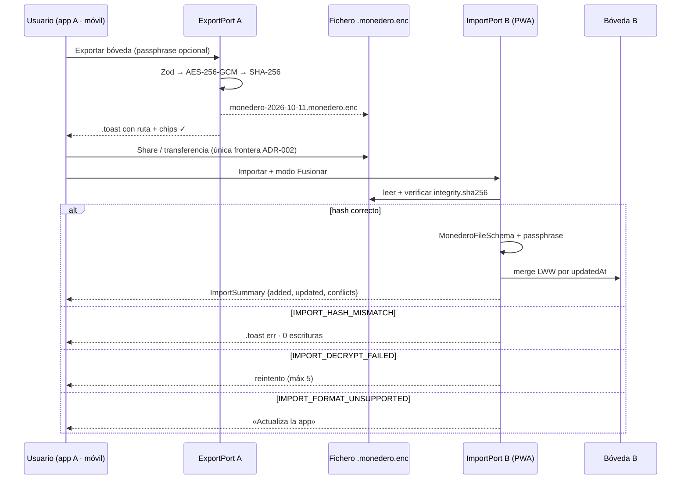
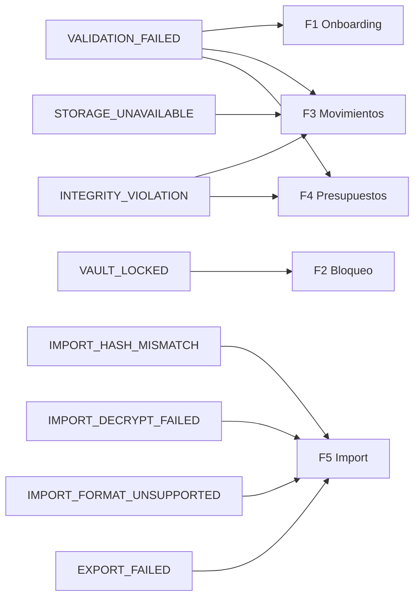

# Flujos de Usuario — Monedero

> **Fase 3 · Paso 5** · Fuente de verdad de happy paths y flujos alternativos/borde.
> **Showcase interactivo:** `Artefactos/documentacion/Flujos/FLUJOS_VISUAL.html` (simulación jugable: 6 flujos · 13 rutas · 64 pasos).
> Todos los flujos respetan la navegación de `ARQUITECTURA_INFORMACION.md` (VaultGate, profundidad ≤3, back predecible).

---

## F1 · Onboarding y creación de bóveda (HU-01·02·18)

```mermaid
flowchart TD
  A[1ª apertura] --> B[Bienvenida]
  B --> C[Passphrase ×2 · .input]
  C -->|mismatch| E1[VALIDATION_FAILED field:confirm]
  E1 --> C
  C -->|ok| D[Modal custodia obligatorio]
  D -->|Cancelar| B
  D -->|Entiendo| F[PBKDF2 120k · .progress]
  F --> G[settings['vault']]
  G --> H[Biometría · .toggle]
  H -->|sin sensor| H2[Botón :disabled + explicación]
  H --> I[Moneda COP/USD/EUR]
  I --> J[Dashboard · estado .empty]
  J --> K[FAB → alta HU-05]

  style E1 fill:rgba(196,69,59,.12)
  style H2 fill:rgba(196,69,59,.12)
```

| Paso | Trigger | Acción | Transición |
|------|---------|--------|------------|
| 1 | Primera apertura | Slides de bienvenida (sin cuentas) | `.btn primary` → paso 2 |
| 2 | Usuario escribe | Dos `.input` + validación en vivo | CTA `:disabled` hasta válido |
| 3 | Confirmar | `.modal` de custodia (obligatorio) | «Entiendo» → derivación |
| 4 | Derivación | PBKDF2 ≥120k, zeroize intermedio | `KeyVaultPort` → Ajustes seguridad |
| 5 | Biometría | Keychain/Keystore + fallback | Paso 4 |
| 6 | Moneda | `settings['currency']` (COP sin decimales) | Dashboard empty |

---

## F2 · Bloqueo y desbloqueo (HU-03·04)

```mermaid
flowchart TD
  A[Bóveda abierta] -->|2 min inactividad o 2.º plano| B[vault:locked]
  B --> C[Zeroize de clave]
  C --> D[VaultGate · pantalla bloqueo]
  D --> E{Método}
  E -->|Biometría| F[.spinner mientras valida SO]
  E -->|Passphrase| F
  F -->|ok| G[vault:unlocked]
  G --> H[Ruta previa: filtros + scroll]
  F -->|fallo| I{Intentos}
  I -->|< 5| D
  I -->|≥ 5| J[Backoff 30 s · :disabled]
  J -->|temporizador| D

  style J fill:rgba(196,69,59,.12)
```

**Reglas:** nunca se borran datos por fallos · biometría y passphrase siempre coexisten · la ruta se conserva (bandera de guarda).

---

## F3 · Registrar un movimiento (HU-05·06·07)

```mermaid
flowchart TD
  A[FAB Añadir] --> B[Sheet alta · .money-input]
  B --> C{Zod valida}
  C -->|importe 0| E1[VALIDATION_FAILED field:amount]
  E1 --> B
  C -->|transf. sin destino| E2[INTEGRITY_VIOLATION + .toast err]
  E2 --> B
  C -->|ok| D[addTransaction]
  D --> F[Evento tx:created]
  F --> G[Fila .tx + balance animado]
  G --> H{¿Borrar?}
  H -->|swipe + Eliminar| I[Soft-delete tombstone]
  I --> J[.toast Deshacer 4 s]
  J -->|Deshacer| K[restore: deleted_at = NULL]
  J -->|expira| L[Borrado lógico propagado en export]

  style E1 fill:rgba(196,69,59,.12)
  style E2 fill:rgba(196,69,59,.12)
```

---

## F4 · Presupuesto y alertas (HU-11·12)

```mermaid
flowchart TD
  A[Presupuestos] --> B[Meta: categoría + importe · YYYY-MM]
  B --> C[budgets.upsert idempotente]
  C -->|duplicado| E1[INTEGRITY_VIOLATION → Editar existente]
  C --> D[Barra 0%]
  D --> E[Gasto acumulado]
  E -->|≥ 80%| F[.progress accent + .toast warn]
  E -->|≥ 100%| G[.progress danger + chip Meta alcanzada]
  F --> H[budget:exceeded]
  G --> H
  H --> I[Copy sereno 4000 ms]
  B -->|Cancelar| J[Vuelta a lista intacta]

  style E1 fill:rgba(196,69,59,.12)
```

**Serenidad:** el aviso informa, no alarmá. `--cs-danger` pinta solo la barra al 100%; los gastos normales nunca se pintan en rojo (SSOT).

---

## F5 · Export ⇄ Import `.monedero` (HU-14·15·16)



**Modo Reemplazar:** snapshot automático previo → doble confirmación (escribir «REEMPLAZAR» en `.modal`) → wipe → import → resumen. Cancelar siempre es seguro (0 escrituras).

---

## F6 · Borrado total (HU-19)

```mermaid
flowchart TD
  A[Ajustes · zona de peligro] --> B[.btn ghost rojo]
  B --> C{¿Copia previa?}
  C -->|Exportar| D[Flujo F5 export]
  C -->|No, continuar| E[Escribir BORRAR en .input]
  D --> E
  E -->|texto incorrecto| E2[CTA deshabilitado]
  E2 --> E
  E -->|ok| F[.modal destructivo]
  F -->|Cancelar| G[Vuelta a Ajustes intacto]
  F -->|Borrar definitivamente| H[DROP tables]
  H --> I[Onboarding HU-01 · estado limpio]

  style E2 fill:rgba(196,69,59,.12)
```

---

## Inventario de flujos alternativos y de borde

| Flujo | Alternativa / borde | Resultado |
|-------|---------------------|-----------|
| F1 | Mismatch de passphrase | `VALIDATION_FAILED` inline; recuperación inmediata sin toasts |
| F1 | Sin biometría en el dispositivo | Botón `:disabled` + explicación; passphrase siempre disponible |
| F2 | 5 fallos de passphrase | Backoff 30 s; la bóveda **nunca** se borra |
| F3 | Importe 0 | Error inline bajo `.money-input`; CTA bloqueado |
| F3 | Transferencia sin destino | `INTEGRITY_VIOLATION`; `category_id = NULL` exigido por CHECK |
| F3 | Borrado accidental | Tombstone + `.toast` «Deshacer» 4 s → `restore` |
| F4 | Meta duplicada en periodo | `INTEGRITY_VIOLATION` + salida elegante «Editar existente» |
| F5 | Fichero alterado | `IMPORT_HASH_MISMATCH`; 0 escrituras |
| F5 | Passphrase del fichero errónea | `IMPORT_DECRYPT_FAILED`; máx. 5 intentos |
| F5 | Versión superior | `IMPORT_FORMAT_UNSUPPORTED`; migraciones solo hacia delante |
| F5 | Reemplazar cancelado | Snapshot descartado; nada cambia |
| F6 | Cancelar borrado | Back a Ajustes intacto, sin toasts de error |

---

## Matriz de códigos de error por flujo


