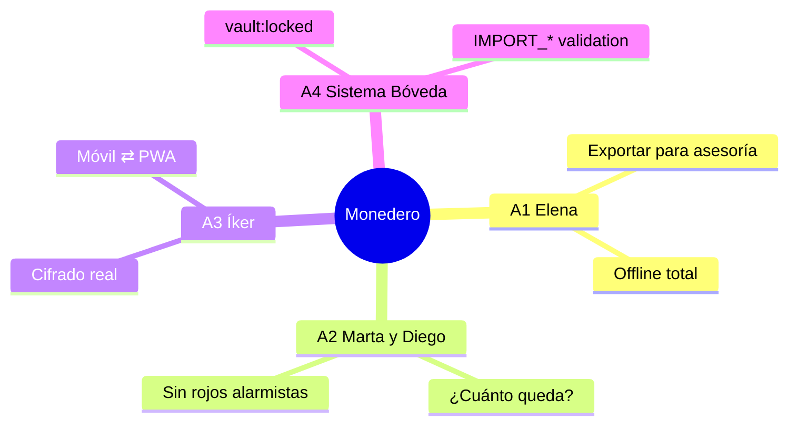

# Requerimientos Funcionales — Monedero

> **Fase 3 · Paso 2** · Fuente de verdad de actores, épicas, historias y criterios de aceptación.
> **Trazabilidad (Regla de Oro):** todo componente citado pertenece al Design System *Clay Serenity*
> (`identidad-visual/manual-identidad-visual.md`, Skill 1); toda entidad/contrato pertenece al modelo
> aprobado (`Arquitectura/MODELO_DE_DATOS.md` y `CONTRATOS_API.md`, Skill 2). Nada inventado.

---

## 1. Actores (Personas)

| # | Actor | Rol | Objetivos | Frustraciones | Expertise |
|---|-------|-----|-----------|---------------|-----------|
| A1 | **Elena** — Freelancer | Principal | Control total de ingresos/gastos; exportar a su asesoría; 100% offline | Apps que monetizan sus datos; mandos lentos y ruidosos | Medio-alto |
| A2 | **Marta & Diego** — Familia | Secundario | Presupuesto mensual y respuesta inmediata: ¿cuánto queda? | Complejidad financiera; rojos alarmistas | Bajo |
| A3 | **Íker** — Privacy-conscious | Early adopter | Cifrado, bóveda bloqueada, intercambio móvil ⇄ PWA, cero nube | Export sin cifrar, cuentas y telemetría | Alto |
| A4 | **Sistema «Bóveda»** | No humano | Custodiar clave (Keychain/Keystore · WebCrypto), bloquear por inactividad, validar importaciones | — | — |



---

## 2. Épicas

| Épica | Título | Historias | Prioridad |
|-------|--------|-----------|-----------|
| **E1** | Onboarding y creación de bóveda | HU-01…02 | MVP |
| **E2** | Seguridad: bloqueo y desbloqueo | HU-03…04 | MVP |
| **E3** | Registro de movimientos | HU-05…07 | MVP |
| **E4** | Dashboard y consulta de balance | HU-08…09 | MVP |
| **E5** | Categorías y etiquetas | HU-10 | MVP |
| **E6** | Presupuestos y alertas | HU-11…12 | MVP |
| **E7** | Reportes mensuales | HU-13 | Alta |
| **E8** | Export/Import `.monedero` (móvil ⇄ PWA) | HU-14…16 | MVP |
| **E9** | Ajustes (moneda, tema, borrado) | HU-17…19 | MVP |
| **E10** | Accesibilidad y estados del sistema | HU-20 | Transversal |

---

## 3. Historias de usuario y criterios de aceptación

### E1 · Onboarding y bóveda

#### HU-01 — Crear bóveda con passphrase
> Como **nuevo usuario**, quiero **crear mi bóveda con passphrase**, para **empezar a registrar gastos con cifrado**.

- **Given** primera apertura (sin `settings['vault']`).
- **When** escribo passphrase (≥10) y confirmación en `.input`.
- **Then** se deriva clave PBKDF2 ≥120.000 → se crea `settings['vault']` → Dashboard en estado `.empty`.

Criterios:
- [ ] Aviso obligatorio «no existe recuperación» (`.modal`) antes de continuar.
- [ ] Mismatch → `VALIDATION_FAILED` con `field`, error inline `.fhint error`.
- [ ] Progreso de derivación con `.spinner`/`.progress` sin congelar la UI.

#### HU-02 — Activar biometría
> Como **usuario**, quiero **activar la biometría**, para **abrir sin escribir la passphrase**.

- **Given** bóveda creada; Ajustes → Seguridad.
- **When** pulso `.btn primary` «Activar biometría».
- **Then** FaceID/huella libera la clave del Keychain/Keystore; fallback passphrase siempre disponible.

Criterios:
- [ ] Sin sensor → botón `:disabled` + explicación.
- [ ] `.toggle` refleja `KeyVaultPort.hasKey()`.

### E2 · Seguridad

#### HU-03 — Bloqueo automático
> Como **usuario**, quiero **que la bóveda se bloquee sola**, para **que nadie vea mis datos**.

- **Given** bóveda desbloqueada.
- **When** inactividad 2 min o segundo plano.
- **Then** `vault:locked` → zeroize → pantalla de bloqueo con `.btn primary` «Desbloquear».

Criterios:
- [ ] Sin datos sensibles en consola/logs.
- [ ] Al desbloquear se conserva ruta previa.

#### HU-04 — Desbloqueo biométrico
> Como **usuario**, quiero **desbloquear con biometría**, para **continuar donde estaba**.

- **Given** pantalla de bloqueo.
- **When** biometría valida.
- **Then** se restaura la pantalla previa (filtros, scroll).

Criterios:
- [ ] 5 fallos → backoff exponencial (`:disabled` con temporizador).
- [ ] Passphrase alternativa siempre visible.

### E3 · Movimientos

#### HU-05 — Alta rápida de gasto
> Como **Elena**, quiero **registrar un gasto rápido**, para **no perder compras**.

- **Given** Home con `BalanceCard`.
- **When** FAB `.btn primary` → `.money-input` + `.input` concepto + `.segmented` tipo + `.chip` categoría.
- **Then** `addTransaction` (Zod) → evento `tx:created` → fila `.tx` + balance animado.

Criterios:
- [ ] Importe 0 → `VALIDATION_FAILED` inline.
- [ ] `inputmode="decimal"` y montos `tabular-nums`.
- [ ] Submit deshabilitado si `formState.isValid === false`.

#### HU-06 — Ingresos y transferencias
> Como **usuario**, quiero **registrar ingresos y transferencias**, para **reflejar la realidad**.

- **When** elijo *Ingreso* (categorías income) o *Transferencia* (cuenta destino).
- **Then** transferencia exige `to_account_id`, `category_id = NULL` (CHECK BD) y no suma a ingresos/gastos.

Criterios:
- [ ] Cambio en `.segmented` no pierde el importe.
- [ ] Misma origen/destino → `INTEGRITY_VIOLATION` + `.toast err`.

#### HU-07 — Editar / borrar con deshacer
> Como **usuario**, quiero **editar o borrar un movimiento**, para **corregir errores**.

- **When** tap/swipe en fila `.tx` → bottom sheet *Editar*/*Eliminar*.
- **Then** editar = `update`; eliminar = soft-delete (tombstone) + `.toast` «Deshacer» 4 s.

Criterios:
- [ ] Deshacer invoca `restore` (limpia `deleted_at`, no borra fila).
- [ ] Targets ≥44px; `.modal` solo si tiene nota adjunta.

### E4 · Dashboard

#### HU-08 — Balance total y del mes
> Como **Marta**, quiero **ver el balance total y del mes**, para **saber «¿cuánto queda?»**.

- **Then** `BalanceCard` muestra Σ `accounts` + delta del mes (contador animado); loading = skeleton.

Criterios:
- [ ] Delta con signo + ícono (nunca solo color).
- [ ] `prefers-reduced-motion` → valor directo.

#### HU-09 — Filtro de periodo
> Como **Elena**, quiero **filtrar por periodo**, para **revisar semanas concretas**.

- **When** `.segmented` Semana/Mes/Año.
- **Then** `getByMonth` reconsulta; vacío → `.empty` con CTA.

### E5 · Organización

#### HU-10 — Categorías y etiquetas
> Como **usuario**, quiero **crear categorías y etiquetas**, para **organizar**.

- **Then** `categories`/`tags` (UNIQUE COLLATE NOCASE); duplicado → `INTEGRITY_VIOLATION`.

Criterios:
- [ ] Color restringido a tokens `--cs-*`.
- [ ] Categoría con movimientos se archiva, no se borra.

### E6 · Presupuestos

#### HU-11 — Meta mensual por categoría
> Como **Marta**, quiero **fijar un presupuesto por categoría**, para **controlar el mes**.

- **Then** `budgets.upsert` idempotente (UNIQUE(category,period)); importe ≤0 → `VALIDATION_FAILED`.

#### HU-12 — Alertas 80% / 100%
> Como **usuario**, quiero **avisos al superar el presupuesto**, para **reaccionar a tiempo**.

- **Then** `.progress` → `accent` (80%) y `danger` (100%) + `.toast warn` vía `budget:exceeded`.

Criterios:
- [ ] Toast no bloquea la UI; 4000 ms.
- [ ] Copy empático: informa, no alarmá.

### E7 · Reportes

#### HU-13 — Reporte mensual con donut
> Como **Elena**, quiero **un reporte mensual con donut**, para **entregarlo a mi asesoría**.

- **Then** `computeMonthReport` → donut (paleta semántica, `role="img"` + `aria-label`) + tabla `.tx`.

### E8 · Export / Import

#### HU-14 — Exportar bóveda cifrada
> Como **Íker**, quiero **exportar mi bóveda cifrada**, para **mover datos móvil → PWA**.

- **Then** `.monedero.enc` vía Share con hash SHA-256 e `integrity`. La passphrase nunca se escribe en el fichero.

#### HU-15 — Importar con merge LWW
> Como **usuario**, quiero **importar en la otra plataforma**, para **continuar allí**.

- **Then** `MonederoFileSchema` → merge LWW → `ImportSummary {added,updated,conflicts}`.
- Errores: `IMPORT_HASH_MISMATCH` · `IMPORT_FORMAT_UNSUPPORTED` · `IMPORT_DECRYPT_FAILED`.

#### HU-16 — Reemplazar con protección
> Como **usuario**, quiero **un modo «Reemplazar» con protección**, para **restaurar un backup**.

- **Then** snapshot automático previo → wipe → import → resumen. Modal exige acción deliberada.

### E9 · Ajustes

#### HU-17 — Tema claro/oscuro
> **Then** `settings['theme']`; variantes SSOT (tierra `#1B1815`). Opción «Sistema» respeta `prefers-color-scheme`.

#### HU-18 — Moneda COP / USD / EUR
> Como **usuario**, quiero **ver y registrar montos en COP, USD o EUR con formato regional**, para **que las cifras hablen mi moneda**.

- **Then** `Intl.NumberFormat`: `COP $ 1.250.000` (0 decimales) · `USD $1,250.00` · `€ 1.250,00`.

Criterios:
- [ ] `accounts.currency` ISO-4217; movimientos heredan la moneda de su cuenta.
- [ ] `amount_cents` sigue siendo entero en el modelo.
- [ ] Cambiar moneda solo reformatea (MVP sin conversión).
- [ ] El export `.monedero` incluye `currency` por registro.

#### HU-19 — Borrado total
> **Then** escribir «BORRAR» → doble `.modal` → wipe → onboarding. Botón ghost/rojo, nunca primario; ofrece export antes.

### E10 · Transversal

#### HU-20 — Accesibilidad, i18n y estados
> **Then** focus 3px, targets ≥44px, reduced-motion ≤80ms, color + signo/ícono; los 4 estados obligatorios por pantalla con componentes de feedback SSOT; axe-core sin violaciones AA en CI.

Criterios adicionales (correctivo auditoría B3-03 — i18n):
- [ ] Cero strings hardcodeados visibles: todo texto vía `t('clave')` (es-CO SSOT, en-US).
- [ ] Test de expansión de texto +30% (simulado de-DE) sin desbordes en CTAs ni cifras.
- [ ] Montos formateados con `formatMoney` único (COP 0 decimales · USD/EUR 2) según locale y moneda de la cuenta.

---

## 4. Diagrama de dependencias entre épicas

```mermaid
graph LR
  E1[E1 Onboarding] --> E2[E2 Seguridad]
  E2 --> E3[E3 Movimientos]
  E3 --> E4[E4 Dashboard]
  E3 --> E5[E5 Categorías]
  E5 --> E6[E6 Presupuestos]
  E4 --> E7[E7 Reportes]
  E4 --> E8[E8 Export/Import]
  E1 --> E9[E9 Ajustes]
  E8 --> E9
  E10[E10 A11y transversal] -.aplica a todas.-. E1
  E10 -.-> E9
```

## 5. Requisitos no funcionales heredados (trazabilidad)

| Requisito | Origen |
|-----------|--------|
| A11y WCAG AA, focus ring, ≥44px, reduced-motion | SSOT Skill 1 |
| Offline 100%, sin red, sin telemetría | ADR-001 (Skill 2) |
| 60fps en springs; skeletons en cargas | Presupuesto rendimiento (arquitectura) |
| Cifrado SQLCipher / WebCrypto, PBKDF2 120k, zeroize | OWASP + GUIA_DEVOPS |
| Multi-moneda COP/USD/EUR (formato, sin conversión en MVP) | Ampliación aprobada en Paso 2 |
