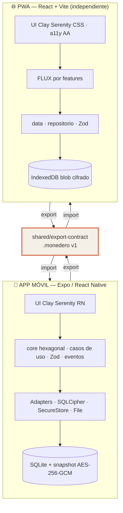
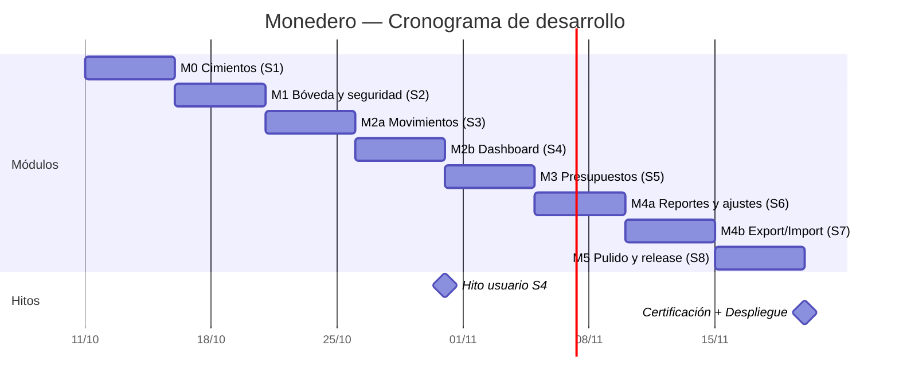

<div align="center">

# 💸 Monedero

### **El gestor de gastos que jamás te pedirá tu dinero — ni tus datos.**

**Local-first · Cero backend · Cero telemetría · Cero nube**

[](https://github.com/uskein/Monedero/actions/workflows/pr.yml)
[](https://github.com/uskein/Monedero/actions/workflows/release.yml)
[](https://github.com/uskein/Monedero#-licencia)
[](https://nodejs.org)
[](https://pnpm.io)
[](https://www.typescriptlang.org)
[](https://github.com/uskein/Monedero/actions)
[](https://www.w3.org/TR/WCAG21/)
[](https://github.com/uskein/Monedero)

</div>

---

## 📖 Índice

| # | Sección | # | Sección |
|---|---|---|---|
| 1 | [⏱️ TL;DR](#tldr) | 12 | [🧪 Tests y puertas de calidad](#tests-y-puertas-de-calidad) |
| 2 | [🛡️ Manifiesto de privacidad](#manifiesto-de-privacidad) | 13 | [🚀 CI/CD y despliegue](#cicd-y-despliegue) |
| 3 | [✨ Funcionalidades](#funcionalidades) | 14 | [🌳 Estructura del repositorio](#estructura-del-repositorio) |
| 4 | [📱 vs 🌐 Dos apps, un contrato](#dos-apps-un-contrato) | 15 | [🗺️ Hoja de ruta y sprints](#hoja-de-ruta-y-sprints) |
| 5 | [🧱 Stack tecnológico](#stack-tecnologico) | 16 | [📐 ADRs — decisiones de arquitectura](#adrs) |
| 6 | [🏗️ Arquitectura](#arquitectura) | 17 | [🧾 Deuda técnica conocida](#deuda-tecnica) |
| 7 | [🗄️ Modelo de datos](#modelo-de-datos) | 18 | [📚 Documentación](#documentacion) |
| 8 | [📦 El contrato `.monedero`](#contrato-monedero) | 19 | [🤝 Contribuir](#contribuir) |
| 9 | [🔐 Seguridad](#seguridad) | 20 | [📜 Licencia](#licencia) |
| 10 | [🎨 Identidad visual — Clay Serenity](#identidad-visual-clay-serenity) | 21 | [❓ FAQ](#faq) |
| 11 | [🌍 i18n y accesibilidad](#i18n-y-accesibilidad) | 22 | [🧭 Otros proyectos](#otros-proyectos) |

---


<h2 id="tldr">⏱️ TL;DR</h2>

**Monedero** es un gestor de finanzas personales que vive **íntegramente en tu dispositivo**.

No hay servidores. No hay cuentas. No hay telemetría. No hay "sincroniza con la nube". Tus gastos, tus ingresos, tus presupuestos y tus categorías se quedan en tu teléfono o en tu navegador, **cifrados**, y solo salen de ahí cuando **tú** lo decides — al exportar un archivo `.monedero` que llevas en un pendrive.

Es **dos aplicaciones independientes** que comparten un único contrato de archivo:

| | 📱 **Móvil** | 🌐 **PWA** |
|---|---|---|
| **Stack** | Expo SDK 57 · React Native 0.86.3 · React 19.2 | React 19.2 · Vite 6 · Vitest 4 |
| **Patrón** | Hexagonal ligera (Ports & Adapters) | FLUX por features |
| **Persistencia** | `expo-sqlite` nativo + snapshot cifrado | `sql.js` (WASM) + IndexedDB |
| **Cifrado** | AES-256-GCM + SecureStore/Keystore | WebCrypto AES-256-GCM + PBKDF2 |
| **Estado** | Zustand | Zustand por feature |
| **Distribución** | EAS Build → App Store / Play Store | Cloudflare Pages (hosting estático) |

> **El producto *es* la ausencia de backend.** El copy y el diseño jamás dirán "sube a la nube" — es un pilar de marca, no una limitación.

```bash
git clone https://github.com/uskein/Monedero.git
cd Monedero
pnpm install
pnpm dev:web      # → http://localhost:5173
```

---


<h2 id="manifiesto-de-privacidad">🛡️ Manifiesto de privacidad</h2>

> *«Soberanía» es el primer pilar del Design System. No es un feature: es la arquitectura.*

### Las 7 garantías

| # | Garantía | Cómo se cumple |
|---|---|---|
| 1 | 🏠 **Cero backend** | No existe un servidor en el código. Ni REST, ni GraphQL, ni WebSocket, ni cola. No hay `API_URL` que apunte a nadie. |
| 2 | 🛰️ **Cero telemetría** | Ni analytics, ni crash reporting, ni beacons, ni fingerprinting. El `logger` es local y **sin PII** (nunca registra importes, concepts ni notas). |
| 3 | 🔒 **Cifrado en reposo** | La sesión vive cifrada: AES-256-GCM sobre el snapshot de la BD, clave maestra custodiada por el Keychain (iOS) / Keystore (Android) / CryptoKey no extraíble (web). |
| 4 | 🧠 **El usuario es su propio custodio** | No hay "olvidé mi contraseña" porque **no hay servidor** que la guarde. La passphrase es la clave: si la pierdes, los datos se pierden. La UI lo advierte. |
| 5 | 🔌 **Offline real** | 100% funcional sin red. La PWA instala un *service worker* cache-first; el móvil no necesita conexión para nada. |
| 6 | 🚪 **Sin salidas ocultas** | Ningún analytics oculto, ninguna petición saliente, ningún permiso de red en el bundle de producción. |
| 7 | 🧾 **Auditable** | Todo es *local-first* y auditable: schema SQL versionado, migraciones numeradas, contrato de exportación con hash SHA-256 verificable. |

### Lo que **NO** es Monedero

- ❌ No es un "gestor de gastos con cuenta en la nube".
- ❌ No tiene registro, ni login remoto, ni recuperación de contraseña.
- ❌ No cobra suscripciones, no anuncia, no perfila.
- ❌ No sube tus datos "para mejorar el producto".

### El único acoplamiento del universo

Dos aplicaciones, dos arquitecturas distintas, **un único punto de contacto**: el archivo `.monedero`.

```
   📱 Móvil  ──── export ────┐
                              │  .monedero (AES-256-GCM + SHA-256)
   🌐 PWA     ──── import ────┘
```

Todo lo demás es independiente: una app puede vivir sin la otra, con arquitecturas que se optimizan para su ecosistema. Esto está decidido y documentado en el [ADR-002](#adrs).

---


<h2 id="funcionalidades">✨ Funcionalidades</h2>

### 10 pantallas · 20 historias de usuario · 4 estados obligatorios por vista

| Blueprint | Pantalla | Móvil | PWA | Descripción |
|---|:---:|:---:|:---:|---|
| **BP-01** | Onboarding | ✅ | ✅ | Crear bóveda en 4 pasos: passphrase, custodia, biometría, moneda |
| **BP-02** | VaultGate | ✅ | ✅ | Bloqueo/desbloqueo global, *zeroize*, backoff tras 5 fallos, restauración de ruta |
| **BP-03** | Inicio (Dashboard) | ✅ | ✅ | BalanceCard con contador animado, segmented de periodo, resumen del mes |
| **BP-04** | Movimientos | ✅ | ✅ | Lista con filtros, búsqueda, categorías, swipe-deshacer 4 s, ventana incremental |
| **BP-05** | Alta de movimiento | ✅ | ✅ | Formulario con validación Zod inline, monto en centavos, tipo, categoría |
| **BP-06** | Presupuestos | ✅ | ✅ | Barras semánticas, umbrales 80 % / 100 %, toast `budget:exceeded` |
| **BP-07** | Reportes | ✅ | ✅ | Donut accesible + tabla alternativa, breakdown por categoría |
| **BP-08** | Ajustes | ✅ | ✅ | Categorías, moneda (COP/USD/EUR), tema, recurrencias, datos |
| **BP-09** | Exportar bóveda | ✅ | ✅ | Serializa → AES-256-GCM → SHA-256 → Share nativo / descarga |
| **BP-10** | Importar bóveda | ✅ | ✅ | Zod → hash → decrypt → merge LWW o *replace* con snapshot previo |

### Detalle de capacidades

**💰 Dinero real, nunca coma flotante**
Todos los importes viven como `amountCents: number` (enteros). El formateo a texto ocurre **solo** en la capa de presentación (`formatMoney` en `@monedero/i18n`), con las reglas por moneda: COP 0 decimales, USD/EUR 2 decimales, separador regional según locale.

**🏷️ Categorías jerárquicas + etiquetas**
Categorías con padre (`parent_id`), unicidad de nombre, archivado lógico. Etiquetas libres con relación N:M (`tags` / `transaction_tags`). Todo con `deleted_at` para que los borrados se propaguen al importar.

**📅 Recurrencias**
Modelo de recurrencias (`003_recurrences.sql`) para gastos e ingresos periódicos: mensual, semanal, quincenal. Preparado para la lógica automática de la fase 2 (ADR-001 lo veta para el MVP, el modelo no).

**💸 Transferencias**
Un movimiento `type='transfer'` mueve dinero entre cuentas (`from_account_id` → `to_account_id`): no cuenta como ingreso ni gasto en reportes, solo cambia la composición del patrimonio.

**🧾 Estados de pendiente**
Cada movimiento tiene `status`: `pending` (chip *Pendiente*, no confirmado por el banco) o `cleared`. Los reportes distinguen ambos.

**↩️ Deshacer**
Swipe para deshacer un alta/borrado con ventana de 4 segundos y estado visual optimista.

**🪙 Multi-moneda de formato**
COP · USD · EUR, seleccionable globalmente. **Sin conversión automática** (decisión explícita: MVP solo formatea, la moneda es la de la cuenta).

**🌗 Modo oscuro**
Variantes de tokens derivadas de la misma SSOT — tierra profunda, **nunca** `#000`.

**♿ Accesibilidad como requisito, no como extra**
Roles y labels ARIA, foco visible, `prefers-reduced-motion`, contraste verificado (AA/AAA) en cada token de color, y una suite **axe-core** que corre en CI sobre el design system **y sobre la app real**.

---


<h2 id="dos-apps-un-contrato">📱 vs 🌐 Dos apps, un contrato</h2>

El [ADR-002](https://github.com/uskein/Monedero/blob/main/Artefactos/documentacion/Arquitectura/README_ARQUITECTURA.md) decide —con aprobación explícita del usuario— que **no se comparte UI entre plataformas**. Cada app usa el patrón natural de su ecosistema.

| Dimensión | 📱 Móvil | 🌐 PWA |
|---|---|---|
| **Motor de datos** | `expo-sqlite` **nativo** (SQLite real) en memoria + snapshot cifrado | `sql.js` (WASM) persistido en IndexedDB cifrado |
| **Por qué** | SQLite nativo rinde en el hilo de JS y compila con Hermes | En browser no existe SQLCipher: el cifrado va en la capa de aplicación |
| **Capa de cifrado** | AES-256-GCM sobre el snapshot con clave de bóveda | WebCrypto `AES-256-GCM` + `PBKDF2` 120 000 iteraciones |
| **Custodia de clave** | `expo-secure-store` → Keychain / Keystore | `CryptoKey` no extraíble, solo en memoria de sesión |
| **Navegación** | Stack propio tipado sobre `core` | Router declarado en `app/` |
| **Animaciones** | Reanimated 3 (UI thread → 60 fps) | CSS transitions + `usePrefersReducedMotion` |
| **Distribución** | EAS Build → App Store + Google Play | Cloudflare Pages (hosting estático, sin backend) |
| **Estado global** | Zustand | Zustand (store por feature) |

> **¿Por qué no RN Web compartido?** Porque el coste de mantener dos implementaciones del Design System se paga **con una SSOT + `tokens:check`**, mientras que compartir código de UI entre RN y DOM genera una abstracción más pobre que dos implementaciones honestas. Decisión documentada, con consecuencias asumidas.

---


<h2 id="stack-tecnologico">🧱 Stack tecnológico</h2>

### Móvil — `apps/mobile`

| Categoría | Elección | Versión |
|---|---|---|
| Framework | Expo SDK | `~57.0.28` |
| Runtime | React Native | `0.86.3` |
| UI | React | `19.2.3` |
| Lenguaje | TypeScript (`strict`) | `~6.0.3` |
| Estado | Zustand | `^5.0.5` |
| Validación | Zod | `^3.25.0` |
| BD | `expo-sqlite` (nativo) | `~57.0.4` |
| Cripto | `@noble/ciphers` · `@noble/hashes` | `^2.4.0` |
| Keystore | `expo-secure-store` · `expo-local-authentication` | `~57.0.4` |
| Ficheros | `expo-document-picker` · `expo-sharing` · `expo-print` | `~57.x` |
| Gráficos | `react-native-svg` · `react-native-view-shot` | `15.15.4` |
| Tests | Jest + `jest-expo` + React Native Testing Library | `^29.7.0` |

### PWA — `apps/web`

| Categoría | Elección | Versión |
|---|---|---|
| Framework | React | `19.2.3` |
| Bundler | Vite | `^6.3.5` |
| Lenguaje | TypeScript (`strict`) | `^5.8.0` |
| Estado | Zustand | `^5.0.5` |
| Validación | Zod | `^3.25.0` |
| BD | `sql.js` (WASM) | `^1.14.2` |
| Cripto | WebCrypto nativo (`crypto.subtle`) | — |
| PWA | `vite-plugin-pwa` (Workbox, cache-first shell) | `^1.0.0` |
| Tests | Vitest 4 + Testing Library + `jest-axe` | `^4.1.11` |

### Compartido — `shared/*` + raíz

| Paquete | Propósito |
|---|---|
| `@monedero/tokens` | **SSOT visual.** Tokens `--cs-*` en JSON ⇄ CSS vars ⇄ constantes RN. `tokens:check` verifica coherencia y que no haya HEX fuera de la paleta. |
| `@monedero/i18n` | **es-CO ⇄ en-US** con paridad forzada (202 claves) + `formatMoney` (centavos ⇄ display). |
| `@monedero/db` | Migraciones/seed **SQL versionadas** — la fuente de verdad del esquema. |
| `@monedero/export-contract` | El **único acoplamiento** entre apps: esquema Zod, envelope, hash, merge LWW, migraciones del formato. |
| **Raíz** | pnpm 10 + Turborepo 2 · TypeScript 5.8 · ESLint 9 (flat config) · Prettier 3 |

---


<h2 id="arquitectura">🏗️ Arquitectura</h2>

### Monorepo pnpm + Turborepo



### Reglas de dependencia (inviolables)

```
apps ──▶ shared/*          (solo contratos, tokens, i18n, schema)
core  ✗──▶ UI / RN / DOM   (el dominio no importa nada de la plataforma)
apps  ✗──▶ apps            (cero imports cruzados — lo verifica contract:check)
```

### Los 4 estados obligatorios

Toda pantalla implementa **loading · empty · error (+ retry) · success**. No son "por hacer": son parte del blueprint y están diseñados, no improvisados.

### Capas del core móvil (hexagonal ligera)

```
apps/mobile/src/
├── core/                  ← dominio puro, cero React, cero SQLite
│   ├── domain/            money · transaction · budget · category · recurrence · monthReport
│   ├── usecases/          addTransaction · computeBalance · evaluateBudgets · …
│   ├── ports/             TransactionRepository · KeyVaultPort · ExportPort · CryptoPort
│   ├── validation/        Zod en toda frontera
│   ├── events/            tx:created · budget:exceeded · …
│   └── errors.ts          errores tipados {code, field?}
├── infrastructure/        ← adapters: db · security · export · file
├── state/                 ← Zustand (síntesis de eventos → estado de UI)
├── hooks/
└── ui/                    ← screens · design-system · navigation
```

### Capas de la PWA (FLUX por features)

```
apps/web/src/
├── features/              ← cada carpeta es autocontenida
│   ├── vault/             store · Onboarding · VaultGate
│   ├── dashboard/         store · DashboardScreen · useCountUp
│   ├── transactions/      store · TransactionForm · TransactionList · presentTx
│   ├── budgets/           store · BudgetsScreen
│   └── settings/          store · SettingsScreen · CategoriesManager · DataPanel
├── data/                  ← domain · repo (sql.js) · crypto (aesGcm · kdf) · db
├── design-system/         ← 14 componentes + showcase
└── app/
```

---


<h2 id="modelo-de-datos">🗄️ Modelo de datos</h2>

**8 tablas · 3 migraciones · money en enteros.**

| Tabla | Propósito | Notas clave |
|---|---|---|
| `accounts` | Cuentas/Carteras | `type` (`cash`/`bank`/`credit`), `currency` ISO-4217 |
| `categories` | Categorías jerárquicas | `parent_id`, nombre único, archivado lógico |
| `transactions` | Movimientos | `amount_cents INTEGER`, `type` (`income`/`expense`/`transfer`), `status` (`pending`/`cleared`) |
| `tags` | Etiquetas | N:M con transacciones |
| `transaction_tags` | Puente N:M | `transaction_id` + `tag_id` |
| `budgets` | Presupuestos | `period`, `limit_cents`, `threshold` 80/100 |
| `settings` | Clave-valor | `format_version`, `vault` (kdf + iterations + verifier) |
| `import_log` | Auditoría de importaciones | Conflictos resueltos por LWW |

### Las 5 decisiones de datos

| Decisión | Por qué | Alternativa descartada |
|---|---|---|
| `amount_cents INTEGER` | Precisión exacta; nunca coma flotante | `REAL` → errores de redondeo |
| PK `TEXT` UUID v4 | Merge seguro móvil ⇄ PWA sin colisiones | `AUTOINCREMENT` → colisiona al importar |
| `deleted_at TEXT NULL` | *Tombstones*: los borrados se propagan al exportar | `hard delete` → imposible sincronizar borrados |
| `PRAGMA foreign_keys = ON` + `CHECK` | 2ª frontera de validación, tras Zod | Sin `CHECK` → corrupción silenciosa |
| `updated_at` ISO-8601 UTC | Motor de merge **LWW** determinista | Merge por campos → complejidad sin beneficio |

> ⚠️ **Nunca** `FLOAT`/`REAL` en dinero. Nunca `DELETE` físico de un movimiento. Nunca una coma flotante en el dominio.

### Migraciones

| # | Fichero | Contenido |
|---|---|---|
| 001 | `shared/db/sql/001_init.sql` | Esquema base (8 tablas + 8 índices) |
| 002 | `shared/db/sql/002_categories_name_unique.sql` | Unicidad de nombre de categoría |
| 003 | `shared/db/sql/003_recurrences.sql` | Modelo de recurrencias |

---


<h2 id="contrato-monedero">📦 El contrato <code>.monedero</code></h2>

El **único** mecanismo de intercambio entre plataformas. Versionado, validado, cifrado y con hash verificable.

### Formato del envelope

```jsonc
{
  "formatVersion": 1,
  "exportedAt": "2026-10-13T18:04:11.000Z",
  "vaultId": "0f3c…-…-…-…-…",     // UUID v4
  "currency": "COP",
  "integrity": { "sha256": "…64 hex…" },
  "data": { "transactions": [], "categories": [], "budgets": [], "tags": [] }
}
```

### Pipeline de exportación

```
snapshot BD → serializar → AES-256-GCM (clave de bóveda) → envelope + SHA-256 → .monedero
```

### Pipeline de importación (en ese orden, obligatoriamente)

```
parsear → validar (Zod) → verificar SHA-256 → descifrar → merge LWW → ImportSummary
```

| Modo | Semántica |
|---|---|
| **merge** | Por UUID, gana el `updated_at` más reciente. Reporta conflictos. |
| **replace** | Destructivo, exige **doble confirmación** y **snapshot previo** de la BD actual. |

### Motor de merge — LWW

```
para cada entidad por UUID:
    si no existe local           → insertar
    si existe y remote.updatedAt > local.updatedAt → reemplazar (y propagar tombstone)
    si no                        → conservar local
```

Determinista, simple y auditable. `ImportSummary` reporta exactamente qué se insertó, actualizó, conservó y omitió.

---


<h2 id="seguridad">🔐 Seguridad</h2>

### Modelo de custodia

```
   passphrase (usuario)  ──PBKDF2 120k──▶  clave maestra  ──▶  AES-256-GCM
                                                   │
                                     ┌─────────────┴─────────────┐
                                  SecureStore              CryptoKey
                                 (Keychain/Keystore)     (no extraíble)
```

### Matriz de controles

| Control | Móvil | PWA |
|---|---|---|
| Derivación de clave | PBKDF2 120 000 iteraciones | PBKDF2 120 000 iteraciones (WebCrypto) |
| Cifrado simétrico | AES-256-GCM (`@noble/ciphers`) | AES-256-GCM (WebCrypto `crypto.subtle`) |
| Integridad | SHA-256 sobre el fichero | SHA-256 sobre el fichero |
| Custodia de la clave | Keychain (iOS) / Keystore (Android) | `CryptoKey` no extraíble, en memoria |
| Bloqueo de sesión | `VaultGate` global + `zeroize` | `VaultGate` global + `zeroize` |
| Anti-fuerza bruta | Backoff tras 5 intentos fallidos | Backoff tras 5 intentos fallidos |
| Validación de entrada | Zod en toda frontera + `CHECK` SQL | Zod en toda frontera + `CHECK` SQL |
| Consultas | SQL parametrizado (sin concatenación) | SQL parametrizado (sin concatenación) |
| Logs | Sin importes, concepts ni notas (A09) | Sin importes, concepts ni notas (A09) |
| Biometría | `expo-local-authentication` (opcional) | — |

### Honestidad sobre el modelo de amenazas

- ✅ **Protegido contra**: pérdida del dispositivo, lectura casual del almacenamiento, robo del fichero `.monedero` exportado, intercepted del fichero cifrado, malformed inputs, y corrupción por SQL.
- ❌ **No protegido contra**: un dispositivo **rooteado/jailbroken** con acceso root al proceso, un keylogger, o un atacante que **conoce la passphrase**. La passphrase es el eslabón; no hay recuperación porque no hay servidor.
- ⚠️ **La UI advierte** de esto: la pérdida de passphrase = pérdida de datos. No es un descuido, es una consecuencia de que el usuario es su propio custodio.

---


<h2 id="identidad-visual-clay-serenity">🎨 Identidad visual — Clay Serenity</h2>

**Claymorphism terroso con lenguaje editorial.** Arcilla moldeada y papel artesanal: superficies con volumen, tacto y calidez.

| Pilar | Significado en UI |
|---|---|
| **Soberanía** | Todo es local. Nunca pedir "subir a la nube" en copy ni en UI. |
| **Serenidad** | Sin rojos alarmistas gratuitos ni urgencia visual. |
| **Claridad** | Una idea por pantalla; jerarquía fuerte; aire generoso. |
| **Tacto** | Botones que se hunden, tarjetas que se elevan; feedback físico. |

### Paleta (SSOT verificada)

| Token | HEX | Rol | Contraste |
|---|---|---|---|
| `--cs-bg-base` | `#F4EFE7` | Fondo (papel hueso) | — |
| `--cs-surface` | `#FFFFFF` | Cards elevadas, sheets | — |
| `--cs-surface-sunken` | `#EAE2D6` | Inputs, tracks, segmentados | — |
| `--cs-primary` | `#2F7D5B` | CTA, éxito, ingresos | 5.2:1 ✅ AA |
| `--cs-primary-hover` | `#276B4E` | Hover/active | ✅ |
| `--cs-accent` | `#D97757` | Íconos, gráficos, énfasis | 3.4:1 ⚠️ solo ≥18px |
| `--cs-accent-text` | `#B4573A` | Terracota como texto | 4.8:1 ✅ AA |
| `--cs-secondary` | `#3D5A80` | Enlaces, series de gráfico | 7.0:1 ✅ AAA |
| `--cs-danger` | `#C4453B` | Errores y destrucción | 5.4:1 ✅ AA |
| `--cs-text-primary` | `#232A31` | Texto principal | 13.1:1 ✅ AAA |
| `--cs-text-muted` | `#6E7681` | Texto secundario | 4.9:1 ✅ AA |

### Las 7 prohibiciones (aplicadas y verificadas por `tokens:check`)

1. ❌ `#D97757` (accent) como color de **texto pequeño** → usar `#B4573A`.
2. ❌ `#C4453B` (danger) para montos de gasto habituales → el gasto es información, no culpa.
3. ❌ Negros puros (`#000`) o blancos puros como fondo de superficie.
4. ❌ Colores fuera de la paleta: nada de `#FF0000`, azules saturados, degradados multicolor.
5. ❌ `bg-base` como color de texto, o `surface` como color de texto.
6. ❌ Fondos saturados detrás de párrafos largos.
7. ❌ Rojo en iconos de "gasto" por defecto.

### Tipografía

| Rol | Familia | Peso | Uso |
|---|---|---|---|
| Display | **Fraunces** | 600–700 | H1, H2, cifras de datos (tabular) |
| UI | **Inter** | 400–600 | Cuerpo, etiquetas, botones |
| Datos | Fraunces / Inter | 700 / 600 tabular | Montos — siempre cifras tabulares |

### Design System

| Plataforma | Componentes | Notas |
|---|---|---|
| 🌐 PWA | **14** | Button · Card · Chip · EmptyState · Input · Modal · MoneyInput · Progress · Segmented · Skeleton · Spinner · Toast · Toggle · TxRow |
| 📱 Móvil | **11** | Button · Card · DonutChart · IconButton · Input · MoneyInput · ProgressBar · Select · Toast · BusyIndicator |

> El design system es **dualmente implementado** pero **únicamente definido una vez**: la SSOT (`@monedero/tokens`) + `pnpm tokens:check` bloquean cualquier HEX suelto o token divergente.

---


<h2 id="i18n-y-accesibilidad">🌍 i18n y accesibilidad</h2>

### Internacionalización

- **Dos locales completos**: `es-CO` (por defecto) y `en-US`.
- **202 claves** con **paridad forzada** — `pnpm i18n:check` falla si falta una clave en cualquiera de los dos.
- **Cero strings hardcodeados** en JSX de producto — todo pasa por `t()`. El gate lo verifica automáticamente.
- **Formato regional**: `es-CO` → `$1.234.567` · `en-US` → `$1,234,567`.
- **Formato de dinero por moneda**: COP 0 decimales · USD/EUR 2 decimales. **Sin conversión** (decisión de producto).

### Accesibilidad — WCAG 2.1 AA

| Requisito | Implementación |
|---|---|
| Contraste | Verificado token por token (AA en texto, AAA en títulos) |
| Roles y labels | ARIA explícito; donut con `aria-label` **+ tabla alternativa** |
| Teclado | Foco visible (`--cs-focus-ring` + `--cs-focus-outline`), orden natural |
| Movimiento | `prefers-reduced-motion` respetado en ambas apps |
| Color | Nunca es el único portador de significado: **signo + ícono + color** |
| Automatizado | **axe-core** en CI sobre el design system **y sobre la app real** (onboarding, app desbloqueada, ajustes) — 3/3 sin violaciones |

---


<h2 id="tests-y-puertas-de-calidad">🧪 Tests y puertas de calidad</h2>

### El número actual

| Suite | Runner | Tests | Estado |
|---|---|---|---|
| 📱 Móvil | Jest 29 + `jest-expo` + RNTL | **196** | ✅ 24/24 suites |
| 🌐 PWA | Vitest 4 + Testing Library | **226** | ✅ 24/24 archivos |
| 🌍 i18n | Vitest | **33** | ✅ |
| 🗄️ DB | Vitest | **16** | ✅ |
| 📦 Contrato | Vitest | **27** | ✅ |
| | | **498** | ✅ **100 % verde** |

Incluye **jornadas E2E de usuario** (`journey-f3`, `journey-f4`): alta → balance → deshacer, y presupuestos de punta a punta.

### Las 5 puertas que bloquean el merge

```bash
pnpm typecheck        # TS strict en los 6 paquetes
pnpm lint             # ESLint 9 flat config
pnpm test             # 498 tests
pnpm tokens:check     # coherencia SSOT visual + cero HEX fuera de paleta
pnpm i18n:check       # paridad es-CO ⇄ en-US + cero strings hardcodeados
pnpm contract:check   # sincronización del contrato .monedero (ADR-002)
```

### Cobertura

Mínimo **≥70 %** en código de negocio, con **TDD estricto** en las rutas de dinero (`amountCents`, merge LWW, evaluación de presupuestos, cripto de la bóveda).

---


<h2 id="cicd-y-despliegue">🚀 CI/CD y despliegue</h2>

### `pr.yml` — Quality gate en cada Pull Request

```
gates compartidas   tokens:check · contract:check · i18n:check · audit (prod-critical)
gates móvil         typecheck · lint · jest + coverage
gates web           typecheck · lint · vitest + coverage · axe-core
```

### `release.yml` — Tag `v*`

```
tag v1.0.0
   ├──▶ PWA   → build → Cloudflare Pages (producción) → GitHub Release
   └──▶ Móvil → EAS Build (all) → EAS Submit (App Store + Google Play)
```

### Secretos requeridos (configura en GitHub → Settings → Secrets)

| Secreto | Uso |
|---|---|
| `CLOUDFLARE_API_TOKEN` | Deploy a Cloudflare Pages |
| `CLOUDFLARE_ACCOUNT_ID` | Deploy a Cloudflare Pages |
| `EXPO_TOKEN` | EAS Build / Submit |

> 🔒 **Nunca en el repo.** Los *store credentials* (App Store Connect `.p8`, service account de Play) se gestionan con `eas credentials` — cifrados en EAS.

### Los `.bat` de arranque rápido (Windows)

```bat
ejecutar-movil.bat   :: Metro en :8081 → abre Expo Go en tu móvil
ejecutar-pwa.bat     :: Vite dev server → la PWA en el navegador
```

---


<h2 id="estructura-del-repositorio">🌳 Estructura del repositorio</h2>

```
Monedero/
├── apps/
│   ├── mobile/                    📱 Expo SDK 57 · RN 0.86 · hexagonal ligera
│   │   ├── src/
│   │   │   ├── core/              dominio puro (domain · usecases · ports · validation · events)
│   │   │   ├── infrastructure/    adapters (db · security · export · file)
│   │   │   ├── state/             Zustand
│   │   │   ├── hooks/
│   │   │   └── ui/                screens · design-system · navigation
│   │   ├── tests/                 unit · journey (Jest + RNTL)
│   │   ├── assets/                icon.png · adaptive-icon.png
│   │   ├── app.json · eas.json · jest.config.js · metro.config.js
│   │   └── package.json           @monedero/mobile
│   │
│   └── web/                       🌐 React 19 · Vite 6 · FLUX por features
│       ├── src/
│       │   ├── app/               App.tsx
│       │   ├── features/          vault · dashboard · transactions · budgets · settings
│       │   ├── data/              domain · repo · crypto · db
│       │   ├── design-system/     14 componentes + base.css + components.css
│       │   └── main.tsx
│       ├── public/                manifest.webmanifest · sw.js · icon-192 · icon-512
│       ├── tests/                 unit · a11y · journey (Vitest + Testing Library)
│       └── package.json           @monedero/web
│
├── shared/
│   ├── tokens/                    🎨 SSOT visual (JSON ⇄ CSS vars ⇄ RN)
│   ├── i18n/                      🌍 es-CO · en-US · formatMoney
│   ├── db/                        🗄️ migraciones SQL versionadas
│   └── export-contract/           📦 el único acoplamiento (Zod · envelope · hash · merge)
│
├── tools/                         🔧 tokens-check · i18n-check · sync-contract · postinstall
│
├── Artefactos/documentacion/      📚 la documentación aprobada (SSOT del proyecto)
│   ├── Arquitectura/              README_ARQUITECTURA · MODELO_DE_DATOS · CONTRATOS_API · ESTRUCTURA_DIRECTORIOS · GUIA_DEVOPS_SEGURIDAD
│   ├── Producto y Flujos/         REQUERIMIENTOS_FUNCIONALES · BLUEPRINTS_DE_PANTALLAS · FLUJOS_DE_USUARIO
│   ├── Diseño Visual/             manual-identidad-visual.md · assets-isotipo
│   ├── Calidad y Gobernanza/      MANIFIESTO_CALIDAD · ESTANDAR_* · GOBERNANZA_GIT · CERTIFICACION_FINAL_S8
│   ├── Orquestador/               PLAN_DE_SPRINTS
│   ├── Blueprints/ · Flujos/ · Prototipos/ · DesignSystem/ · DocumentacionMaestra/
│
├── .github/workflows/             pr.yml · release.yml
├── AGENTS.md · CONTRIBUTING.md · README.md
├── package.json · turbo.json · pnpm-workspace.yaml · tsconfig.base.json · eslint.config.js
└── ejecutar-movil.bat · ejecutar-pwa.bat
```

### Métricas del repositorio

| Métrica | Valor |
|---|---|
| Commits | **89** |
| Ficheros versionados | **295** |
| LOC (TS · TSX · SQL · CSS) | **~22 400** |
| Suites de test | **52** |
| Tests | **498** |
| Paquetes | **6** (4 shared + 2 apps) |
| Pantallas (blueprints) | **10** |
| Épicas · Historias de usuario | **10 · 20** |
| ADRs | **8** |

---


<h2 id="hoja-de-ruta-y-sprints">🗺️ Hoja de ruta y sprints</h2>

**Plan completo en [`PLAN_DE_SPRINTS.md`](Artefactos/documentacion/Orquestador/PLAN_DE_SPRINTS.md).**

| Sprint | Módulo | Entrega | % |
|---|---|---|---|
| **S1** | M0 · Cimientos del monorepo | ✅ Entregado | 12 % |
| **S2** | M1 · Bóveda y seguridad | ✅ Entregado | 37 % |
| **S3** | M2a · Movimientos: dominio y alta | ✅ Entregado | 50 % |
| **S4** | M2b · Dashboard y consulta | ✅ Aprobado por el usuario 🎯 | 62 % |
| **S5** | M3 · Organización y presupuestos | ✅ Gate certificado | 75 % |
| **S6** | M4a · Reportes, apariencia y moneda | ✅ Entregado (móvil) | 87 % |
| **S7** | M4b · Soberanía: Export ⇄ Import | ✅ Aprobado por el usuario 🎯 | 95 % |
| **S8** | M5 · Pulido, i18n, a11y y release | ✅ **Proyecto certificado** 🎯 | 100 % |



### Fuera de alcance del MVP (decidido, no olvidado)

- ❌ Sync en vivo / WebSockets / backend de cualquier tipo
- ❌ Cuentas de usuario, OAuth, recuperación remota de contraseña
- ❌ Conversión multi-moneda en vivo (se almacena ISO-4217; el cambio es manual)
- ❌ Recurrencias automáticas (el modelo ya está; la lógica va en fase 2)
- ❌ Colaboración familiar multiusuario (futuro: el mismo archivo como canal)

---


<h2 id="adrs">📐 ADRs — decisiones de arquitectura</h2>

Cada decisión tiene contexto, alternativas descartadas y consecuencias asumidas. Fuente: [`README_ARQUITECTURA.md`](Artefactos/documentacion/Arquitectura/README_ARQUITECTURA.md).

| ADR | Decisión | Consecuencia clave |
|---|---|---|
| **001** | Local-first sin backend | ✅ Soberanía total, offline, coste ~0 · ❌ sin sync en vivo (mitigado con export/import) |
| **002** | Dos apps independientes, único acoplamiento por archivo | ✅ Independencia total · ❌ UI implementada dos veces (mitigada con SSOT + `tokens:check`) |
| **003** | SQLite cifrado (SQLCipher móvil / WebCrypto web) | ✅ Encryption at-rest real · ❌ sin recuperación de passphrase |
| **004** | Dinero en enteros + UUID v4 + borrado lógico | ✅ Integridad exacta y merges seguros |
| **005** | Hexagonal (móvil) vs FLUX (web) | ✅ Cada app usa el patrón natural de su ecosistema |
| **006** | Merge LWW por `updatedAt` | ✅ Determinista y simple · ❌ edits simultáneos muy raros pueden perder el más viejo |
| **007** | React + Vite (no Next.js) para la PWA | ✅ Build mínimo, SW simple, deploy estático |
| **008** | Motor de sesión = `expo-sqlite` nativo en memoria + snapshot cifrado | ✅ Builds release con Hermes, SQLite nativo, cifrado intacto |

> **ADR-008 en detalle:** el motor interim `sql.js` (asm.js) alcanzaba niveles de anidamiento que el compilador Hermes rechaza en builds release (límite duro ~1000, `facebook/hermes#628`) → imposible generar APK/AAB. La sesión corre ahora sobre `expo-sqlite` **nativo** con la BD **en memoria**, y el snapshot AES-256-GCM sigue siendo la **única** persistencia en disco: cero plaintext en reposo, semántica idéntica.

---


<h2 id="deuda-tecnica">🧾 Deuda técnica conocida</h2>

Honesta, trazable y fechada. No se esconde nada.

| # | Deuda | Impacto | Se resuelve |
|---|---|---|---|
| **D1** | El fichero de la BD aún no es SQLCipher a nivel de fichero (el cifrado real ya está activo vía snapshot AES-256-GCM) | Bajo | Dev-build EAS propio |
| **D2** | PWA sin la capa S6 completa (tema claro/oscuro, moneda global, reportes, zona de peligro) — entregada en móvil | Medio | Sprint de paridad |
| **D3** | Coverage ≥80 % sin auditar en cada iteración (CI ya ejecuta `--coverage`) | Bajo | Tras el primer CI en verde |
| **D4** | Advisories sin parche upstream en el toolchain de Expo (2 altos + 2 moderados, build-time) | **Nulo en producción** | Cuando Expo actualice sus deps transitivas |
| **D5** | Skeletons shimmer (hoy: BusyIndicator con identidad de marca) | Cosmético | Mejora futura |
| **D6** | Secrets de CI/CD sin configurar en GitHub | Bloquea el release automático | Acción del usuario |

---


<h2 id="documentacion">📚 Documentación</h2>

La documentación **es** el proyecto. Vive en [`Artefactos/documentacion/`](Artefactos/documentacion) y es la fuente de verdad.

### Documentos maestros

| Documento | Qué define |
|---|---|
| [`Arquitectura/README_ARQUITECTURA.md`](Artefactos/documentacion/Arquitectura/README_ARQUITECTURA.md) | Stack, patrones, 8 ADRs, directrices de código |
| [`Diseño Visual/manual-identidad-visual.md`](Artefactos/documentacion/Dise%C3%B1o%20Visual/manual-identidad-visual.md) | **SSOT visual**: concepto, tokens, color, tipografía, movimiento, a11y, modo oscuro |
| [`Producto y Flujos/REQUERIMIENTOS_FUNCIONALES.md`](Artefactos/documentacion/Producto%20y%20Flujos/REQUERIMIENTOS_FUNCIONALES.md) | Actores (Elena, Marta & Diego, Íker), 10 épicas, 20 HU con criterios de aceptación |
| [`Producto y Flujos/BLUEPRINTS_DE_PANTALLAS.md`](Artefactos/documentacion/Producto%20y%20Flujos/BLUEPRINTS_DE_PANTALLAS.md) | BP-01…BP-10 con los 4 estados por pantalla |
| [`Producto y Flujos/FLUJOS_DE_USUARIO.md`](Artefactos/documentacion/Producto%20y%20Flujos/FLUJOS_DE_USUARIO.md) | F1…F8, recorridos de usuario |
| [`Arquitectura/MODELO_DE_DATOS.md`](Artefactos/documentacion/Arquitectura/MODELO_DE_DATOS.md) | ERD, DDL, diccionario de datos, estrategia de migración |
| [`Arquitectura/CONTRATOS_API.md`](Artefactos/documentacion/Arquitectura/CONTRATOS_API.md) | Puertos, errores tipados, contratos del `.monedero` |
| [`Arquitectura/ESTRUCTURA_DIRECTORIOS.md`](Artefactos/documentacion/Arquitectura/ESTRUCTURA_DIRECTORIOS.md) | Estructura y convenciones de carpetas |
| [`Arquitectura/GUIA_DEVOPS_SEGURIDAD.md`](Artefactos/documentacion/Arquitectura/GUIA_DEVOPS_SEGURIDAD.md) | Entorno, variables, CI/CD, protocolos de seguridad |
| [`Calidad y Gobernanza/MANIFIESTO_CALIDAD.html`](Artefactos/documentacion/Calidad%20y%20Gobernanza/MANIFIESTO_CALIDAD.html) | **Estándares inquebrantables**: tests, i18n, a11y, observabilidad, git, flags |
| [`Calidad y Gobernanza/CERTIFICACION_FINAL_S8.md`](Artefactos/documentacion/Calidad%20y%20Gobernanza/CERTIFICACION_FINAL_S8.md) | Evidencia de la certificación final + deuda registrada |
| [`Orquestador/PLAN_DE_SPRINTS.md`](Artefactos/documentacion/Orquestador/PLAN_DE_SPRINTS.md) | Cronograma, dependencias, riesgos, % de avance |

### HTML interactivo (demos navegables)

| Artefacto | Contenido |
|---|---|
| [`Prototipos/prototipo-a-sovereign-vault.html`](Artefactos/documentacion/Prototipos/prototipo-a-sovereign-vault.html) | Concepto original *Sovereign Vault* |
| [`Prototipos/prototipo-b-clay-serenity.html`](Artefactos/documentacion/Prototipos/prototipo-b-clay-serenity.html) | Diseño aprobado *Clay Serenity* |
| [`Blueprints/BLUEPRINTS_VISUAL.html`](Artefactos/documentacion/Blueprints/BLUEPRINTS_VISUAL.html) | Los 10 blueprints renderizados |
| [`Flujos/FLUJOS_VISUAL.html`](Artefactos/documentacion/Flujos/FLUJOS_VISUAL.html) | Los 8 flujos de usuario |
| [`DesignSystem/COMPONENTS_SHOWCASE.html`](Artefactos/documentacion/DesignSystem/COMPONENTS_SHOWCASE.html) | Showcase del design system |
| [`DocumentacionMaestra/PRODUCTO_VISUAL_HUB.html`](Artefactos/documentacion/DocumentacionMaestra/PRODUCTO_VISUAL_HUB.html) | Hub de navegación de todo el producto |

> Ábrelos directamente en el navegador — son HTML autocontenidos, sin build.

---


<h2 id="contribuir">🤝 Contribuir</h2>

Lee [`CONTRIBUTING.md`](CONTRIBUTING.md) antes de abrir un PR.

### Flujo

```
main (protegido, checks verdes)  ←  PR  ←  feature/* | fix/*
```

1. Rama `feature/<tema>` o `fix/<tema>` desde `main`.
2. Commits semánticos (commitlint): `feat(scope):`, `fix(scope):`, `test(scope):`, `docs(scope):`.
3. Pull Request → **todas** las gates de `.github/workflows/pr.yml` en verde.
4. Merge a `main`.

### Las 8 reglas innegociables

| Regla | Detalle |
|---|---|
| **Sin strings hardcodeados** | Todo texto de UI pasa por `@monedero/i18n` con clave en **ambos** locales. `pnpm i18n:check` lo bloquea. |
| **Solo tokens `--cs-*`** | Colores, espaciados y radios desde `@monedero/tokens`. Nada de HEX en la UI. `pnpm tokens:check` lo bloquea. |
| **Dinero en centavos** | `amountCents: number` (enteros). El formateo vive en `shared/i18n`. |
| **El frontend jamás escribe SQL** | Toda persistencia pasa por el repositorio (`Repository` port) con SQL tipada y migraciones versionadas. |
| **4 estados por pantalla** | loading · empty · error (+retry) · success. Diseñados, no improvisados. |
| **WCAG 2.1 AA** | Roles/labels accesibles; el axe de `tests/*-a11y.test.tsx` debe pasar. Sin rojo para gastos ordinarios. |
| **El contrato `.monedero` es intocable a la ligera** | Cambios solo en `shared/export-contract` + fixtures + `pnpm contract:check`. |
| **Tests del código de negocio** | Cobertura ≥70 % en código de negocio (rutas de dinero: TDD estricto). |

### Checklist antes de abrir PR

```bash
pnpm typecheck && pnpm lint && pnpm test
pnpm tokens:check && pnpm i18n:check && pnpm contract:check
```

---


<h2 id="licencia">📜 Licencia</h2>

**Proyecto privado — desarrollado por y para [Uskein](https://github.com/uskein).**

Sin licencia pública explícita: todos los derechos reservados por defecto. Este repositorio se publica como **referencia técnica y de proceso** (arquitectura, design system, puertas de calidad, documentación). No se concede derecho de uso, copia o distribución del código.

Si quieres reutilizar alguna parte —el design system *Clay Serenity*, los tokens, los gates de calidad o el contrato `.monedero`—, **abre una issue y lo hablamos**.

> El código de terceros mantiene su licencia original (Expo, React Native, Zod, Vitest, Fraunces bajo SIL OFL 1.1, etc.).

---


<h2 id="faq">❓ FAQ</h2>

**¿Hay que crear cuenta?**
No. Ni en la app, ni en GitHub, ni en ningún sitio. El primer arranque es crear la bóveda.

**¿Y si pierdo la passphrase?**
Los datos se pierden. No hay servidor, así que no hay "restablecer contraseña". Es el precio — y la garantía — de que nadie más que tú puede leerlos. La app te avisa antes de que esto te sorprenda.

**¿Cómo hago backups?**
Exporta el `.monedero` cifrado y guárdalo donde quieras (nube, pendrive, email a ti mismo). Es un archivo; funciona igual que un `.zip` de tus finanzas.

**¿Puedo usar la PWA y el móvil a la vez?**
Sí, pero **no se sincronizan solos**. Exportas desde una y importas en la otra; el merge es LWW por `updatedAt` y te reporta los conflictos. Es deliberado: la sincronización en vivo requeriría un servidor.

**¿Funciona sin internet?**
Sí, al 100 %. La PWA instala un service worker cache-first; el móvil no necesita conexión para nada.

**¿Móvil o PWA?**
El móvil es la app principal (más completa). La PWA es para escritorio y para cuando quieres proyectar tus finanzas en una pantalla grande.

**¿Qué pasa con el soporte multi-moneda?**
Puedes guardar en COP, USD y EUR y elegir el formato. **No hay conversión automática** — es una decisión de producto, no una carencia: convertir requiere una tasa de cambio que alguien tiene que mantener, y en local-first eso no existe.

**¿Por qué dos bases de datos distintas (SQLite nativo en móvil, sql.js en web)?**
Porque SQLCipher no existe en browser. En móvil se usa SQLite nativo con snapshot cifrado; en web, `sql.js` con el cifrado en la capa de aplicación (WebCrypto). El modelo de datos, el contrato y el dominio son **idénticos**.

**¿Puedo contribuir?**
Lee [`CONTRIBUTING.md`](CONTRIBUTING.md). Respeta las 8 reglas innegociables y todas las gates deben estar en verde.

---


<h2 id="otros-proyectos">🧭 Otros proyectos</h2>

| Proyecto | Qué es |
|---|---|
| [📓 FitJournal](https://github.com/uskein/FitJournal) | Bitácora de vida y gimnasio, 100 % local (SQLite). Diario creativo + rutinas + progreso. React Native + Expo. |
| [🫀 Hábitos — Pulse Clay](https://github.com/uskein/habitos) | App local-first de hábitos, metas y bienestar (Expo + SQLite). |
| [📚 PLPDF — Biblioteca Imperial](https://github.com/uskein/plpdf) | Lector de PDF/EPUB con colecciones, anotaciones y cuadernos. |
| [🎬 PLMP4 — Video Library](https://github.com/uskein/plmp4) | Biblioteca de vídeo con progreso, etiquetas y listas. |

> Todos comparten la misma obsesión: **los datos del usuario son del usuario**.

---

<div align="center">

### 💸 Monedero

**Hecho con 🧱 capas, 🔒 cifrado y ☕ determinismo.**

```
89 commits · 498 tests · 0 backends · 0 telemetrías · 100 % verde
```

</div>
